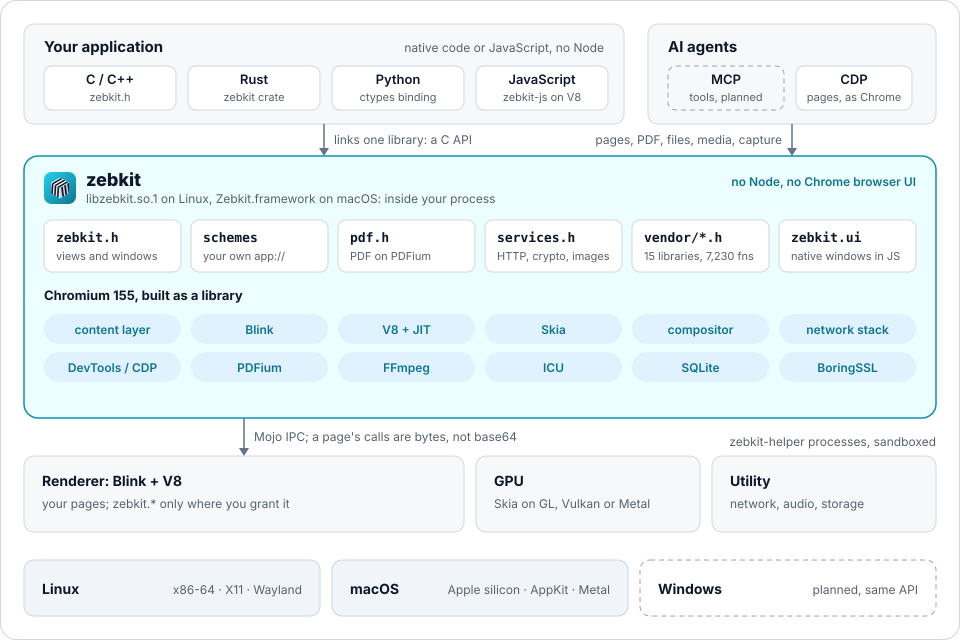
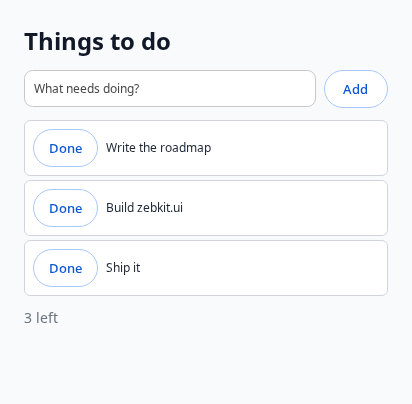

<h1 align="center"></h1>

<p align="center"><b>All of Chrome's power. None of its weight.</b></p>

## Introduction

zebkit is Chromium's content layer and Blink built as one shared library
with a helper program, and nothing of Chrome's browser. An application
links it, opens web pages in its windows, serves the Chrome DevTools
Protocol to agents, and calls the libraries Chromium already carries
through a C API, with bindings for Rust, Python and the pages' own
JavaScript. There is no Node and no second runtime: the application is
native code, or JavaScript on the engine's own V8.

<p align="center"></p>

- **No Node.** No second JavaScript runtime and no IPC through one. The
  application is native code, or JavaScript run by `zebkit-js` on the
  engine's V8.
- **Bytes as they are.** A page's calls to the application go over a
  scheme of the engine's own, through Mojo's data pipes: no base64, no JSON
  around binary data, many calls under way at once.
- **Chromium's libraries are yours.** 15 C libraries inside the engine,
  7,230 functions, exported under `zebkit_vendor_*`: SQLite, BoringSSL,
  zlib, Zstandard, Brotli, ICU, HarfBuzz, libxml2, libwebp, libjpeg-turbo,
  FFmpeg, dav1d, Opus, libvpx and PDFium. You do not ship them twice.
- **PDF built in.** A full API on Chromium's PDFium: rendering and tiles,
  text with layout, search, outline, links, annotations with appearances,
  forms, redaction, page editing, merging, attachments, metadata, and
  signatures checked for integrity. In C and in page JavaScript.
- **Your own URL schemes.** `app://` answered by the application, for page
  loads, `fetch()` and media alike, with files served in ranges so that a
  `<video>` seeks.
- **Native UI from JavaScript.** `zebkit.ui` draws windows with Chromium's
  views toolkit: signals, JSX, Tailwind classes, and automation for tests
  and agents. Its successor, React, Solid or Vue drawn natively with each
  system's look, is planned in `docs/ROADMAP_UI.md`.
- **Made for agents.** zebkit is to be a general MCP tool: one server
  giving an AI agent the engine's whole reach, pages to read and act on,
  PDFs, files, media, images, capture and native windows (planned,
  `docs/ROADMAP.md`). Today agents drive it over CDP, Chromium's own
  DevTools server, headless or windowed.
- **Safe by default.** A page has no `zebkit` object unless the
  application grants it, per view, per origin and per capability; the
  origin is the browser's, never the page's word; the renderer stays
  sandboxed.
- **An engine you can change.** zebkit is Chromium plus a small patch set
  (`patches/`), rebuilt from source; where Chromium lacks something, zebkit
  patches it rather than working around it.

| | |
|---|---|
| Engine | Chromium 155.0.8059.84 (`upstream.lock`): content layer, Blink, V8 with every JIT tier |
| Linux | x86-64, glibc 2.25 or newer: `libzebkit.so.1` and `zebkit-helper` |
| macOS | Apple silicon: `Zebkit.framework`, cross-built on Linux (`docs/MACOS.md`) |
| Windows | Planned, with the same API |
| Version | `VERSION`: 0.0.1-alpha.9 |

## Quick start

### Get the engine

A package is a directory with the library, the helper, the engine's data
and `include/`. Either unpack a release's archive
(`zebkit-<version>-<target>.tar.xz` from GitHub's releases), or build one:

```sh
mise run r      # dist/release (Linux) and dist/release-macos (macOS); hours the first time
```

Building needs about 30 GB for Chromium's tree (`docs/BUILD.md`). Below,
`$PKG` is the package directory.

### A first program in C

```c
#include <stdio.h>
#include <zebkit/zebkit.h>

static void printed(zebkit_view *view, const char *json, const char *error, void *data) {
    printf("%s\n", json ? json : error);
    zebkit_quit();
}

static void loaded(zebkit_view *view, zebkit_load_event event, const char *url, void *data) {
    if (event == ZEBKIT_LOAD_FINISHED)
        zebkit_view_evaluate(view, "document.title", printed, NULL);
}

static void ready(void *data) {
    zebkit_view *view = zebkit_view_new("https://example.com/", 1024, 768);
    zebkit_view_on_load(view, loaded, NULL);
}

int main(int argc, char **argv) {
    return zebkit_main(argc, argv, ready, NULL);
}
```

```sh
cc app.c -I$PKG/include -L$PKG -l:libzebkit.so.1 -Wl,-rpath,$PKG -o app   # Linux
cc app.c -I$PKG/include -F$PKG -framework Zebkit -Wl,-rpath,$PKG -o app   # macOS
./app --remote-debugging-port=9222     # with CDP for Puppeteer and Playwright
```

In a container without unprivileged user namespaces, add `--no-sandbox`.

### The page and the application

The application serves its own pages from a scheme and gives them
functions to call; a page has nothing of `zebkit` unless it is granted.

```c
/* The page calls zebkit.app.greet("Ada"). */
static void greet(zebkit_view *view, const char *origin, const char *args_json,
                  zebkit_call *call, void *data) {
    char answer[256];
    snprintf(answer, sizeof answer, "{\"hello\": %s}", args_json);
    zebkit_call_resolve(call, answer);
}

/* app://main/... from ./ui, in ranges for media. A real handler refuses "..". */
static void serve(zebkit_request *request, void *data) {
    char path[1024];
    snprintf(path, sizeof path, "ui%s", zebkit_request_url(request) + sizeof "app://main" - 1);
    zebkit_request_respond_file(request, path, NULL);
}

static void closed(zebkit_view *view, void *data) { zebkit_quit(); }

static void ready(void *data) {
    zebkit_view *view = zebkit_view_new("app://main/index.html", 1024, 768);
    zebkit_view_grant(view, "app://main", ZEBKIT_ALLOW_APP | ZEBKIT_ALLOW_PDF, NULL);
    zebkit_view_bind(view, "greet", greet, NULL);
    zebkit_view_on_close(view, closed, NULL);
}

int main(int argc, char **argv) {
    zebkit_scheme_register("app", ZEBKIT_SCHEME_STANDARD | ZEBKIT_SCHEME_SECURE | ZEBKIT_SCHEME_FETCH);
    zebkit_scheme_handle("app", serve, NULL);
    return zebkit_main(argc, argv, ready, NULL);
}
```

In the page, every call is a promise and bytes are `Uint8Array`s:

```js
const reply = await zebkit.app.greet('Ada');            // the application's function
const pdf = await zebkit.pdf.open(await (await fetch('report.pdf')).bytes());
const rgba = await pdf.render(0, {scale: 2});           // a page as pixels
const hits = await pdf.search('revenue');
const packed = await zebkit.compress('zstd', bytes, 19);
const hash = await zebkit.crypto.digest('SHA-256', 'abc');
```

### Rust

```toml
[dependencies]
zebkit = "0.0.1-alpha.9"

[build-dependencies]
zebkit-build = "0.0.1-alpha.9"
```

```rust
// build.rs: puts the engine beside the executable
fn main() { zebkit_build::bundle(); }

// main.rs
fn main() {
    std::process::exit(zebkit::run(|| {
        let view = zebkit::View::new(Some("https://example.com/"), 1024, 768);
        view.grant("https://example.com", zebkit::Allow::APP, None);
        view.bind("greet", |call| {
            let answer = format!("\"hello, {}\"", call.args_json());
            call.resolve(&answer)
        });
        view.on_close(zebkit::quit);
    }));
}
```

`ZEBKIT_DIR` points the build at a package (`rust/README.md`).

### Python

```python
import zebkit                      # bindings/python, on ctypes: nothing to compile

def ready():
    view = zebkit.View("https://example.com/")
    view.grant("https://example.com", zebkit.ALLOW_APP)
    view.bind("greet", lambda name, origin: f"hello, {name}")

zebkit.main(ready)                 # the engine is found in $ZEBKIT_DIR
```

### JavaScript, without Node

`zebkit-js` runs an ES module on the engine's V8, as Electron's main
process would, with views, the same APIs, and native windows:

```js
// zebkit-js main.mjs
const view = new zebkit.View('app://main/index.html', {width: 1024, height: 768});
view.grant('app://main', ['app', 'pdf']);
view.bind('save', async (name, text) => {
  await zebkit.fs.writeFile(`${zebkit.args[0]}/${name}`, text);
  return {saved: true};
});
view.on('close', () => zebkit.quit());
```

```js
// zebkit-js todo.mjs: a window of native widgets
const {h, signal, For, window} = zebkit.ui;
const [todos, setTodos] = signal([]);
const [draft, setDraft] = signal('');

window({title: 'To do', width: 420, height: 440}, () =>
  h('view', {class: 'flex-col gap-3 p-6 bg-gray-50'},
    h('input', {placeholder: 'What needs doing?', value: draft, onInput: setDraft,
                onSubmit: () => { setTodos((t) => [...t, draft()]); setDraft(''); }}),
    h(For, {each: todos}, (todo) => h('text', {}, todo)),
    h('text', {class: 'text-sm text-gray-500'}, () => `${todos().length} things`)));
```



### Agents

An MCP server that gives agents zebkit's capabilities as tools is planned
(`docs/ROADMAP.md`, "Agents"). Today an agent drives zebkit over CDP, as it
would drive Chrome:

```sh
tools/zebkit-run --headless --remote-debugging-port=9222 https://example.com/
```

Any CDP client connects to `http://127.0.0.1:9222`.

### The examples

```sh
mise example:linux:basic    # examples/window.c: a browser window
mise example:rust:window    # the same in Rust
mise example:ffmpeg         # examples/ffmpeg.cpp: a library inside the engine
```

## Benchmark

Every comparison is with the latest stable Electron, 44.9 (Chromium 152).
A comparison of whole applications, the same one on both, is still to be
made (`docs/ROADMAP.md`).

| | zebkit 0.0.1-alpha.6 | Electron 44.9, trimmed | zebkit is |
|---|---:|---:|---:|
| Uncompressed | **157.5 MiB** | 255.7 MiB | 38% smaller |
| `.tar.xz` | **53.9 MiB** | 85.3 MiB | 37% smaller |
| `.zip` | **71.9 MiB** | 112.6 MiB | 36% smaller |
| Text layout (an EPUB chapter) | 8.7 ms | **6.8 ms** | 28% slower |
| A web page: CPU in its first 30 s, on average | **4.9 s** | 6.1 s | 21% less |
| A web page: memory, on average | **409 MB** | 492 MB | 17% less |

- **Size.** Electron as shipped is 283.3 MiB; "trimmed" is a hello world
  with its locales and extras removed, the fairest baseline we could make
  (`examples/electron-hello`). zebkit keeps the whole web platform that
  applications use: HTML, CSS, JavaScript with every JIT tier,
  WebAssembly, WebGL, media with H.264 and AAC, HTTP/3.
- **Text layout.** Electron's is Chrome's own build, every hot path
  optimized for speed. zebkit is built with Chromium's PGO profile and
  link-time optimization but optimizes part of the engine for size;
  closing the gap is on the roadmap (`docs/ROADMAP.md`).
- **Web pages.** Twelve popular sites (Wikipedia, YouTube, Amazon, The New
  York Times, GitHub and others) and three local pages, each loaded for
  10 s and shown for 20 s more, each alone in a freshly started engine,
  the median of 3 runs, CPU and memory of every process (the averages
  above are over the 15). A simple page takes 171 MB, two thirds of it
  the engine's own code, which every further page shares. zebkit costs less CPU on 12 of the 15 and less memory on
  13; Stack Overflow is where it costs more (`docs/reports/web-bench.md`,
  `scripts/web-bench.sh`).
- How each number is made: `docs/SIZE_AND_SPEED.md`.

## Reference

### Documentation

| Document | What it covers |
|---|---|
| [docs/API.md](docs/API.md) | Everything an application can call, in C, Rust, Python and JavaScript |
| [docs/BUILD.md](docs/BUILD.md) | Fetching Chromium, building, packaging, testing, measuring and releasing; profiles and patches |
| [docs/ARCHITECTURE.md](docs/ARCHITECTURE.md) | How the engine is made, and what in this repository is what |
| [docs/SIZE_AND_SPEED.md](docs/SIZE_AND_SPEED.md) | Where the size goes, what was cut and kept, the compiler against speed, the Electron baseline |
| [docs/MACOS.md](docs/MACOS.md) | The macOS framework, built on Linux |
| [docs/ROADMAP.md](docs/ROADMAP.md) | The engine: requirements, what is done, what is next |
| [docs/ROADMAP_UI.md](docs/ROADMAP_UI.md) | The UI layer: React, Solid or Vue drawn natively with each system's look, on the desktop, iOS and Android |
| [rust/README.md](rust/README.md) | The Rust crates |
| `docs/reports/` | Size reports, regenerated by the scripts |

### Repository

| Path | What it holds |
|---|---|
| `upstream.lock` | The Chromium release built, the pinned depot_tools, the Electron release measured against |
| `profiles/` | Build flavours as GN arguments: `slim.gn` (the product), `slim-macos.gn`, `baseline.gn` (Chromium's defaults) |
| `patches/` | Changes to Chromium, applied in the order of `patches/series` |
| `src/engine/` | zebkit's own code, linked into Chromium as `//zebkit/engine`: the library, its C API and headers |
| `src/ffmpeg/` | zebkit's FFmpeg configuration, from `scripts/ffmpeg-config.sh` |
| `rust/`, `bindings/python/` | The Rust crates and the Python binding |
| `tools/` | `zebkit-run` (open pages, serve CDP) and `zebkit-js` (applications in JavaScript) |
| `tests/` | Programs that test every layer of the API against a package; speed workloads |
| `examples/` | A browser window in C, `zebkit.ui`, a library inside the engine, the Electron baseline |
| `scripts/` | Every step, one script each; `mise tasks` lists the short forms |

`upstream/` (Chromium's tree, about 30 GB), `out/`, `dist/` and `.cache/`
are generated and not tracked.
