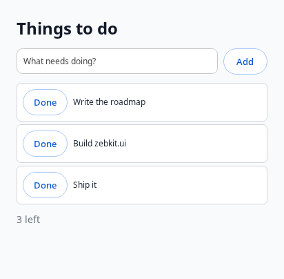

# zebkit's API

What an application gets from the engine. How it works inside is
`docs/ARCHITECTURE.md`; what is still to come, `docs/ROADMAP.md`. The engine is
`libzebkit.so.1`, with `zebkit-helper` beside it for the renderer, GPU and
utility processes, and the headers in the package's `include/`.

```sh
cc app.c -I<package>/include -L<package> -l:libzebkit.so.1 -Wl,-rpath,<package>
```

| Layer | Header | What |
|---|---|---|
| 0. Core | `<zebkit/zebkit.h>`, `<zebkit/offscreen.h>`, `<zebkit/page.h>` | Start the engine, run its loop, views, script in pages and outside them, native interface (`zebkit.ui`), CDP, calls between the page and the application; views drawn off-screen into shared surfaces; dialogs, printing to PDF, drag and drop |
| 1. Libraries | `<zebkit/vendor/<library>.h>` | The C libraries inside the engine, with their own APIs |
| 2. Services | `<zebkit/services.h>`, `<zebkit/pdf.h>` | Compression, cryptography, URLs, images, ICU's data, HTTP, PDF, over Chromium's own code |
| 3. Bindings | `rust/`, `bindings/python/zebkit` | Layers 0 and 2 for Rust and Python |
| 4. JavaScript | `zebkit.*` in a page | Layers 0 and 2 for the page's script, as the application grants it |

`scripts/engine-test.sh <profile>` tests every layer from programs built
against the package (`tests/engine/`).

## 0. The core

```c
#include <zebkit/zebkit.h>

static void loaded(zebkit_view *view, zebkit_load_event event, const char *url, void *data) {
    if (event == ZEBKIT_LOAD_FINISHED)
        zebkit_view_evaluate(view, "document.title", printed, NULL);
}

static void ready(void *data) {
    zebkit_view *view = zebkit_view_new("https://example.com/", 1024, 768);
    zebkit_view_on_load(view, loaded, NULL);
}

int main(int argc, char **argv) {
    return zebkit_main(argc, argv, ready, NULL);
}
```

- **One call starts and runs the engine.** `zebkit_main()` starts
  Chromium's content layer the way Android WebView does
  (`BrowserMainRunner` initialized by the embedder), calls `ready` on the
  main thread when views can be made, and returns after `zebkit_quit()`.
  Closing the last window does not end it: that is the application's to
  act on. Chromium's switches in `argv` are
  honoured: `--remote-debugging-port`, `--user-data-dir`, `--no-sandbox`,
  `--headless`, `--enable-logging=stderr` and the rest.
- **Lighter than a browser by default.** Third-party cookies are blocked,
  as Safari and Firefox block them: on pages with advertising each network
  that would sync a cookie opens a frame, and with site isolation a
  process (one news site: 63 such frames, 3 without).
  `--zebkit-allow-third-party-cookies` allows them. No spare renderer is
  kept warm for the next navigation, as Electron keeps none;
  `--zebkit-spare-renderer` keeps one. The user agent and client hints are
  Chromium's own for its version, with `--headless` too: Chrome's
  `Chrome/155.0.0.0`, not `HeadlessChrome`, since headless views are shown
  to people and sites take HeadlessChrome for a bot.
  `--zebkit-headless-user-agent` gives Chrome's headless string;
  `--user-agent` replaces it.
- **What sites read to know it is Chrome.** `window.chrome` has
  `chrome.loadTimes()` and `chrome.csi()` from Chrome's renderer, plus the
  legacy `chrome.app` hosted-app queries. Without a hosted-app registry,
  these report `false`, `null`, `cannot_run` and asynchronously
  `not_installed`; no extension runtime is linked. Popups are blocked as
  Chrome blocks them: a page opens a window or a tab only
  while the person clicks or types; `--disable-popup-blocking` lets every
  one open. A headless view's screen is `--window-size`, or 1920 by 1080,
  not Ozone's 1 by 1 pixel. `navigator.webdriver` is as Chrome sets it:
  true with `--enable-automation` or `--remote-debugging-port=0`, the
  ports ChromeDriver uses, false otherwise.
- **A CDP client changes nothing the page sees.** Describing the errors a
  page logs runs none of the page's code (`patches/1026`): Chrome's V8
  calls the page's `Error.prepareStackTrace` and getters on an error when a
  client has `Runtime` enabled, which pages and bot checks read as a
  debugger attached. The client still has each error with its stack
  (`tests/engine/cdp_browser.py`).
- **Google sign-in compatibility.** In the tested slim C host, restoring
  the legacy `chrome.app` queries changed email/Next from an unsafe-browser
  rejection to the password page. Enabling, disabling, then re-enabling
  only this API in the same binary produced pass, rejection (`rrk=46`),
  pass, with fresh profiles on 2026-10-26. This is a reproducible
  compatibility result, not a published Google login requirement or
  official support commitment. Password/MFA and full login were not tested.
  See [the source references and comparison](GOOGLE_SIGNIN.md).
- **A site's "Sign in with ..." popup.** Sites sign in with Google and
  other providers through a popup, as in Firefox: FedCM, which Chrome
  answers with dialogs of its own and the content shell turns down, is off
  (`--zebkit-fedcm` keeps it). The popup opens from the person's click; an
  application that shows it itself takes it with
  `zebkit_view_on_window_open()`, a view still linked to the site
  (`window.opener`, `postMessage()`, `window.closed`), off-screen when the
  site's view is, its frames to draw for the person. Whether the provider
  accepts the sign-in in it is the provider's decision (the compatibility check above);
  once signed in, the session is the profile's (`--user-data-dir`), and a
  headless run with the same profile has it.
- **Threads.** Everything is for the thread that called `zebkit_main()`,
  and every callback runs on it; `zebkit_post_task()` is for any thread.
- **Windows.** A view has a window when there is a display (Wayland or
  X11) and none otherwise; it loads, runs and can be driven over CDP
  either way.
- **Script.** `zebkit_view_evaluate()` runs script in the page and calls
  back with its value as JSON, a promise waited for, or with the message of
  what was thrown. It is Chrome's `Runtime.evaluate`, through an internal
  DevTools session of the view.
- **CDP.** `zebkit_cdp_listen()` serves the Chrome DevTools Protocol from
  Chromium's own DevTools server, which is what Chrome serves with
  `--remote-debugging-port`; `zebkit_cdp_get_url()` is the browser
  target's WebSocket address for Puppeteer and Playwright.
- **Data.** The profile is in `--user-data-dir`, by default
  `$XDG_CONFIG_HOME/zebkit/<program name>`
  (`~/Library/Application Support/zebkit/<program name>` on macOS). The
  log goes to stderr.
- **URL schemes of the application's own.** `zebkit_scheme_register()`,
  before `zebkit_main()`, makes `app:` (say) a scheme of the engine's in
  every process: standard (an origin, relative URLs), secure, open to
  `fetch()`, past pages' Content-Security-Policy, as its flags say.
  `zebkit_scheme_handle()` answers its requests, page loads, subresources,
  `fetch()` and media alike: `zebkit_request_respond()` with a status,
  headers and a body, from any thread, or `zebkit_request_respond_file()`
  with a file read as it is sent, in the range a `Range` header asks for, as
  a `<video>` seeking asks. This is Chromium's way for its own schemes (a
  URL loader factory per scheme in the browser process), and Electron's
  `protocol.handle`. The same from the command line:
  `--zebkit-scheme=app,standard,secure,fetch`.
- **The application.** `zebkit_app_set_menu()` takes the application's
  menu as JSON: items with an id, which the application's function gets,
  standard roles (undo, copy, minimize, quit, ...), submenus and
  separators, each with a key. On macOS it is the menu bar (a first
  `appMenu` menu is the application menu); on Linux and Windows, whose
  windows have no menu bar, the same keys, with Ctrl for ⌘, work in the
  application's windows when the page does not take them.
  `zebkit_app_on_open_files()` gets the files the system opens with the
  application (the Finder, the Dock), `zebkit_app_on_reopen()` the Dock
  icon clicked with no window shown, and `zebkit_app_on_quit_request()`
  ⌘Q and logging out, to quit (`zebkit_quit()`) or not. In Rust
  `zebkit::app`; in Python `zebkit.app_*`.

Every function of `<zebkit/zebkit.h>`, whose comments are the full
reference:

| Functions | What |
|---|---|
| `zebkit_main`, `zebkit_quit`, `zebkit_post_task`, `zebkit_post_delayed_task`, `zebkit_is_headless` | The engine, its loop, its thread |
| `zebkit_version`, `zebkit_engine_version`, `zebkit_free` | Versions; freeing what the engine returns |
| `zebkit_app_set_menu`, `zebkit_app_on_open_files`, `zebkit_app_on_reopen`, `zebkit_app_on_quit_request` | The application's menu and its part in the system |
| `zebkit_view_new`, `_close`, `_load_url`, `_reload`, `_stop`, `_go_back`, `_go_forward`, `_is_loading`, `_get_url`, `_get_title` | A view and its page |
| `zebkit_view_resize`, `_set_size_limits`, `_set_title`, `_focus` | Its window: size, smallest size and whether it may be resized (Electron's `minWidth`, `minHeight`, `resizable`), title, raising |
| `zebkit_view_attach`, `_set_bounds`, `_set_visible` | A view inside another view's window, a browser in an application |
| `zebkit_view_on_load`, `_on_title`, `_on_close` | Loads (started, committed, finished, failed), title changes, closing |
| `zebkit_view_on_new_window` | What a page opens in a new window, to the application as a URL |
| `zebkit_view_on_window_open` | A window a page opens, to the application as a view still linked to its opener (a site's sign-in popup); off-screen when its opener is |
| `zebkit_view_on_drop` | Paths of files dropped on the view; `zebkit.pathForFile()` in the page |
| `zebkit_view_evaluate`, `_add_script` | Script in the page; script in every document before the page's own (a preload) |
| `zebkit_view_set_user_agent`, `zebkit_view_capture` | The User-Agent; the view as PNG, with or without a window |
| `zebkit_view_grant`, `_bind`, `zebkit_call_resolve`, `zebkit_call_reject` | What a page may use of `zebkit.*`; the application's functions it may call |
| `zebkit_script_new`, `_run_module`, `_evaluate`, `_on_idle`, `_destroy` | Script outside any page |
| `zebkit_cdp_listen`, `_get_port`, `_get_url`, `_stop` | The DevTools endpoint |
| `zebkit_scheme_register`, `_handle`, `zebkit_request_url`, `_method`, `_headers`, `_body`, `zebkit_request_respond`, `_respond_file` | URL schemes of the application's own |

## 1. The libraries inside the engine

The application includes the library's header and writes the library's own
API. Every function is exported from the engine as
`zebkit_vendor_<library>_<function>`, and the header maps the one name to
the other, so the engine exports none of the libraries' own names: another
copy of a library in the process, a system one or the application's, is a
different one and does no harm. In C++ the API is also in the namespace
`zebkit::vendor::<library>`.

```c
#include <zebkit/vendor/sqlite.h>
#include <zebkit/vendor/zstd.h>

sqlite3 *db;
sqlite3_open("app.db", &db);
size_t size = ZSTD_compress(out, capacity, data, length, 19);
```

| Library | Header | Functions | Notes |
|---|---|---:|---|
| zlib | `zlib.h` | 88 | Chromium's fork, with its SIMD |
| Zstandard | `zstd.h` | 68 | Compression and decompression |
| Brotli | `brotli.h` | 32 | Encoder and decoder |
| BoringSSL | `boringssl.h` | 2,960 | `libcrypto` and `libssl`; its C++ helpers are left out (`BORINGSSL_NO_CXX`) |
| SQLite | `sqlite.h` | 263 | Built as Chromium builds it: call `sqlite3_initialize()` first (no automatic initialization); exclusive locking by default (`PRAGMA locking_mode=NORMAL` to share a file); no JSON functions, no extensions |
| ICU | `icu.h` | 955 | The C API; call `zebkit_icu_init()` first when the engine is not running. Its data is English, Chinese, Japanese and Korean |
| HarfBuzz | `harfbuzz.h` | 484 | Shaping, OpenType tables, subsetting |
| libxml2 | `libxml.h` | 1,008 | XML and HTML parsing, the tree, XPath, the reader and writer |
| libwebp | `libwebp.h` | 105 | Decoding, encoding, demuxing, muxing |
| libjpeg-turbo | `libjpeg.h` | 63 | The libjpeg API |
| FFmpeg | `ffmpeg.h` | 610 | zebkit's configuration (`src/ffmpeg`, `scripts/ffmpeg-config.sh`): Chrome's demuxers and decoders, and for applications libswresample, libswscale, the file protocol, the MP4, MOV, Matroska and WebM muxers, VP8 and VP9 through the engine's libvpx; no encoders |
| dav1d | `dav1d.h` | 19 | AV1 decoding |
| Opus | `opus.h` | 71 | Encoding and decoding |
| libvpx | `libvpx.h` | 36 | VP8 and VP9, decoding and encoding |
| PDFium | `pdfium.h` | 468 | Chromium's, without XFA forms and its JavaScript; call `FPDF_InitLibrary()` first, or use `<zebkit/pdf.h>` |

7,230 functions in all, and the engine exports nothing else but zebkit's
own API (`scripts/engine-test.sh` checks both). Only the headers the
library's header reaches are shipped, not the library's internals.

What is there is what the engine is built with: a function is exposed when
the library's public headers declare it and the library's compiled objects
define it. `src/engine/vendor/gen_vendor.py` finds them in the build, at
the end of it, and writes the entry points and the headers; nothing is
listed by hand. Chromium renames some libraries' functions (zlib's
`Cr_z_`, SQLite's `chrome_sqlite3_`, ICU's version suffix,
libjpeg-turbo's `chromium_`) with macros in their headers; the generator
follows them. FreeType is not there yet: its headers include one another
through macros, which the package's layout cannot follow.

## 2. Services

`<zebkit/services.h>`: plain functions over Chromium's own code, for what
is not one library's API.

| Functions | What | From |
|---|---|---|
| `zebkit_compress`, `zebkit_decompress` | gzip, zlib, raw deflate, Brotli, Zstandard; a limit against data that expands without end | zlib, Brotli, Zstandard |
| `zebkit_digest_compute`, `zebkit_hmac`, `zebkit_random_bytes`, `zebkit_aes_gcm_seal`, `zebkit_aes_gcm_open` | SHA-1 and SHA-2, HMAC, secure random bytes, AES-GCM | BoringSSL |
| `zebkit_url_get`, `zebkit_url_registrable_domain` | A URL parsed and canonicalized as a browser does, its parts and origin; the registrable domain by the public suffix list | `url/`, `net/` |
| `zebkit_image_decode`, `zebkit_image_encode` | PNG, JPEG and WebP to and from RGBA | `ui/gfx/codec`, libwebp |
| `zebkit_icu_init` | ICU's data, for layer 1's ICU without the engine | `base/i18n` |
| `zebkit_fetch` | An HTTP request through the engine's network stack: HTTP/1.1, 2 and 3, its cache, cookies and proxy settings, without CORS | The network service |

All but `zebkit_fetch()` work without the engine running.

### PDF

`<zebkit/pdf.h>` is documents on Chromium's own PDFium, which is in the
engine (without XFA forms and without PDFium's JavaScript). What it covers
is measured against EmbedPDF's viewer (`docs/ROADMAP.md`).

```c
zebkit_pdf *pdf = zebkit_pdf_open_file("report.pdf", NULL, &error);
char *info = zebkit_pdf_info(pdf);                      /* JSON: pages, metadata, permissions */
zebkit_pdf_render_options tile = {.scale = 2, .background = 0xffffffff,
                                  .x = 0, .y = 0, .width = 512, .height = 512};
uint8_t *rgba = zebkit_pdf_render(pdf, 0, &tile, &width, &height, &error);
char *found = zebkit_pdf_search(pdf, "revenue", 0, 0, 100, &error);
int index = zebkit_pdf_annotation_add(pdf, 0, "{\"type\": \"highlight\", \"rect\": [...], \"quads\": [[...]]}", &error);
uint8_t *bytes = zebkit_pdf_save(pdf, ZEBKIT_PDF_SAVE_INCREMENTAL, &size, &error);
```

| Functions | What |
|---|---|
| `zebkit_pdf_open`, `_open_file`, `_close`, `_save` | Bytes or a file, a password; saved whole or incrementally, with or without its encryption |
| `zebkit_pdf_info`, `_set_metadata` | Pages, version, encryption, permissions, form type, language, the document information |
| `zebkit_pdf_page_count`, `_page` | A page's size as shown, rotation, label and boxes |
| `zebkit_pdf_render`, `_render_annotation` | RGBA at a scale and rotation, the whole page or a tile, with annotations and form fields, on a background; one annotation's appearance alone, for a layer over the page |
| `zebkit_pdf_text`, `_text_layout`, `_text_lines`, `_text_rects`, `_char_at` | The text; each character's box, font, size and angle; lines with their boxes and unmapped characters; selection rectangles; hit testing |
| `zebkit_pdf_images`, `_image_data` | The images a page draws, with their pixel sizes and places (a page that is one image is a scan); one's bytes, its JPEG as stored or its pixels as PNG |
| `zebkit_pdf_search` | Every match in the document, with its rectangles and the text around it |
| `zebkit_pdf_signatures`, `_signature_contents` | The digital signatures, nested form fields too ([`patches/1020`](../patches/1020-pdf-nested-signature-fields.patch)): reason, time, byte range, permissions, the signer's certificate, and whether each is intact: the bytes it covers are those signed, by the signer's key, and it covers the whole file; the PKCS#7 itself. Trust in the certificate is the application's to judge |
| `zebkit_pdf_outline`, `_links` | Bookmarks, link annotations and addresses written in the text |
| `zebkit_pdf_annotations`, `_annotation_add`, `_update`, `_remove`, `_set_image`, `zebkit_pdf_flatten` | Every kind read; highlights, underlines, squiggles, strikeouts, ink, lines, polygons, polylines, squares, circles, notes, free text, links and redaction marks made, changed and removed, with their appearances generated; an image as a stamp's appearance |
| `zebkit_pdf_redact` | What is under the page's redaction marks, or areas given, taken out for good: text character by character, image pixels blacked out, paths and annotations that reach in; boxes drawn over |
| `zebkit_pdf_form_fields`, `_form_set`, `_form_reset` | Every field with its type, value, options and widgets; a value set, check boxes and radio buttons by export value, with the appearance redrawn; the form reset |
| `zebkit_pdf_page_rotate`, `_pages_delete`, `_pages_move`, `_page_insert`, `_pages_import`, `zebkit_pdf_new` | Pages turned, deleted, moved, inserted blank, copied in from another document; a new document to build from others' pages (merge, extract) |
| `zebkit_pdf_attachments`, `_attachment`, `_attach`, `_detach` | Embedded files |

Structured answers are JSON. Coordinates are PDF page space: points, the
origin at the bottom left, before the page's rotation. PDFium is not
thread-safe; the functions take one lock, so any thread may call them.
Where PDFium had nothing for it, zebkit patches PDFium (`patches/1014`,
`1015`, `1020`). Still to come: editing the outline, and trust in a
signer's certificate (`docs/ROADMAP.md`).

In JavaScript the same is `zebkit.pdf` (layer 4), for pages granted
`ZEBKIT_ALLOW_PDF` and for the application's script. A page's documents are
worked on in the browser process, one call at a time on the thread pool;
a page reaches only the documents it opened, and they close with its view.
A PDF is untrusted input, and PDFium in the browser process is outside the
renderer's sandbox: a sandboxed utility process for it is on the roadmap.

## 3. Bindings

`bindings/python/zebkit` is the core and the services for Python, through
`ctypes`, with nothing to compile:

```python
import zebkit

def ready():
    view = zebkit.View("https://example.com/")
    view.grant("https://example.com", zebkit.ALLOW_APP)
    view.bind("greet", lambda name, origin: f"hello, {name}")

zebkit.main(ready)
```

It finds the engine in `$ZEBKIT_DIR`.

`rust/` is the same for Rust: `zebkit-rs` declares the C API, and the
`zebkit` crate is safe Rust over it, with closures for callbacks and the
engine's thread enforced by the types (`rust/README.md`):

```rust
std::process::exit(zebkit::run(|| {
    let view = zebkit::View::new(Some("https://example.com/"), 1024, 768);
    view.grant("https://example.com", zebkit::Allow::APP, None);
    view.bind("greet", |call| {
        let answer = format!("\"hello, {}\"", call.args_json());
        call.resolve(&answer)
    });
    view.on_close(zebkit::quit);
}));
```

## 4. JavaScript in the page

A page the application grants it to has a global `zebkit`:

```js
const sum = await zebkit.app.add(2, 3);               // the application's function
const response = await zebkit.fetch('https://api.example/x', {method: 'POST', body: '{}'});
await zebkit.fs.writeFile('notes.txt', 'text');      // under the directory granted
const packed = await zebkit.compress('zstd', bytes, 19);
const hash = await zebkit.crypto.digest('SHA-256', 'abc');
const {width, height, data} = await zebkit.image.decode(pngBytes);
const url = await zebkit.url.parse('../x', location.href);
```

| Object | Functions |
|---|---|
| `zebkit.app.<name>(...args)` | What the application binds with `zebkit_view_bind()`; arguments and result as JSON |
| `zebkit.fetch(url, {method, headers, body})` | `{status, url, headers, body}`, `body` a `Uint8Array` |
| `zebkit.fs` | `readFile`, `readText`, `writeFile`, `readDir`, `stat`, `mkdir`, `remove(path, {recursive})` |
| `zebkit.compress(format, bytes, level)`, `zebkit.decompress(format, bytes)` | `gzip`, `zlib`, `deflate-raw`, `br`, `zstd` |
| `zebkit.crypto` | `digest(algorithm, data)`, `hmac(algorithm, key, data)`, `randomBytes(count)` |
| `zebkit.image` | `decode(bytes)`, `encode('png' \| 'jpeg' \| 'webp', {width, height, data}, quality)` |
| `zebkit.url` | `parse(url, base)`, `registrableDomain(host)` |
| `zebkit.pdf` | `open(bytes, {password})`, a document with `info`, `page`, `pages` (every page's `page`, in one call), `render(i, {scale, rotation, x, y, width, height})` (RGBA), `renderAnnotation(i, a, {mode, scale, rotation})` and `renderAnnotations(i, {scale, rotation})` (each annotation's appearance alone, for a layer over the page), `text`, `textLayout`, `textLines` (lines with boxes), `textRects`, `charAt`, `search`, `outline`, `signatures`, `links`, `images` (each image's pixel size and place), `imageData` (one's JPEG as stored, or PNG), `annotations`, `annotationsOfPages` (several pages' in one call), `addAnnotation`, `updateAnnotation`, `removeAnnotation`, `setAnnotationImage` (an image as a stamp's appearance) (annotations carry their dictionary's `entries`, which add and update also set), `flatten`, `redact(i, areas, fill)`, `formFields`, `setField`, `resetForm`, `rotatePage`, `deletePages`, `movePages`, `insertPage`, `importPages`, `attachments`, `attach`, `detach`, `setMetadata`, `save`, `close`; `zebkit.pdf.create()` for a new one: `<zebkit/pdf.h>` |
| `zebkit.pathForFile(file)` | A dropped `File`'s path, when the application asked for drops (`zebkit_view_on_drop()`); otherwise `''`. Not a promise |

Every function but `pathForFile` returns a promise; bytes are `Uint8Array`s, and a string is
taken as its UTF-8 where bytes are expected.

**What a page may use is the application's to say**, per view, per origin
and per capability: `zebkit_view_grant(view, "https://app.example",
ZEBKIT_ALLOW_APP | ZEBKIT_ALLOW_FILES, "/path/to/data")`. A view with no
grant gives its pages no `zebkit` at all; in a view with grants, a page of
another origin has the object, and every call it makes is refused.

- **The origin is the browser's**, the committed origin of the frame the
  call came from, not anything the page's script says.
- **Frames of another site never get the object**: they are other
  DevTools targets, which the view's session does not attach to.
- **`zebkit.fs` stays in its directory**: a path with `..`, a symbolic
  link, or one that resolves outside is refused.

How it works: the view's internal DevTools session adds a script that runs
before the page's own (`Page.addScriptToEvaluateOnNewDocument`); the script
makes the `zebkit` object (a load asked for right after the first grant
waits until the browser has the script, so that the new document cannot
miss it). A call is a `POST` to `zebkit://call`, a scheme of the engine's
own that every frame's loader factory serves for that frame alone, so the
browser knows the calling frame and its origin from the factory, not from
the request. The call and its answer are each JSON followed by their bytes
as they are, through Mojo's data pipes: no base64, and many calls under
way at once. The renderer stays sandboxed; the work is done in the browser
process, PDFs, files and compression on Chromium's thread pool.
`zebkit.app` hands the application JSON, with bytes as `{"$bytes":
base64}` both ways.

## Script outside any page

An application can be JavaScript, as Electron's main process is, without
Node: `zebkit_script_new()` makes a V8 context in the application's own
process, on the engine's thread, and `zebkit-js` runs a module with it.

```js
// app.mjs: zebkit-js app.mjs
import {render} from './ui.mjs';                       // ES modules, from files

const view = new zebkit.View('https://app.example/', {width: 1024, height: 768});
view.grant('https://app.example', ['app', 'fetch']);
view.bind('save', async function (name, text) {      // the page calls zebkit.app.save()
  await zebkit.fs.writeFile(`/home/me/notes/${name}`, text);
  return {saved: true, from: this.origin};
});
view.on('load', (event, url) => event === 'finished' && console.log('loaded', url));
view.on('close', () => zebkit.quit());

const packed = await zebkit.compress('zstd', new TextEncoder().encode('...'), 19);
```

| In the script | What |
|---|---|
| `zebkit.View(url, {width, height})` | `load`, `reload`, `back`, `forward`, `resize`, `close`, `url`, `title`, `evaluate(script)`, `grant(origin, capabilities, filesRoot)`, `bind(name, fn)`, `on('load' \| 'title' \| 'close', fn)` |
| `zebkit.fetch`, `fs`, `compress`, `decompress`, `crypto`, `image`, `url`, `pdf` | As in a page (layer 4), with no grant: the script is the application; `fs` takes any path, and `pdf.open` a path as well as bytes |
| `zebkit.args`, `zebkit.quit()`, `zebkit.version`, `zebkit.engineVersion` | |
| `console`, `setTimeout`, `setInterval`, `TextEncoder`, `TextDecoder` | |

Bytes are `Uint8Array`s both ways, without base64: the calls go to the
same code as a page's, in the same process. A function bound with
`bind()` is called with the page's arguments and `this.origin`, and may
return a promise. `zebkit-js` ends when the script calls `zebkit.quit()`,
or once nothing of it is pending (a timer, a call, the module's
evaluation) and no view is open, as Node ends.

Not yet: `import` of anything but files (no packages, no `import()` of a
computed name), and the web's other globals (`URL`, `structuredClone`).

## Native interface: `zebkit.ui`

A script outside any page can make windows of native widgets instead of
web pages: Chromium's `ui/views`, the toolkit Chrome draws its own
interface with on Linux, Windows and macOS, already in the engine. The
model is Native Shell's and Solid's: components run once, signals update
the properties that read them, and the changes go to the native side as
one batch of mount operations per turn of the loop. No DOM, no GTK.

```js
// zebkit-js todo.mjs
const {h, signal, For, window} = zebkit.ui;

const [todos, setTodos] = signal([]);
const [draft, setDraft] = signal('');

window({title: 'To do', width: 420, height: 440}, () =>
  h('view', {class: 'flex-col gap-3 p-6 bg-gray-50'},
    h('text', {class: 'text-2xl font-bold'}, 'Things to do'),
    h('view', {class: 'flex-row gap-2 items-center'},
      h('input', {class: 'grow', placeholder: 'What needs doing?', value: draft,
                  onInput: setDraft, onSubmit: () => { setTodos((t) => [...t, draft()]); setDraft(''); }})),
    h(For, {each: todos}, (todo) => h('text', {}, todo)),
    h('text', {class: 'text-sm text-gray-500'}, () => `${todos().length} things`)));
```



`examples/ui/todo.mjs` is the whole example above, and the picture is it
captured headless with `zebkit.ui.capture()`.

| | |
|---|---|
| Elements | `view` (a flexbox), `text`, `button`, `input`, `image` (PNG, JPEG or WebP bytes as `src`), `scroll`, `web` (a web page, `url`) |
| Properties | `direction`, `gap`, `padding`, `align`, `justify`, `grow`, `width`, `height`, `background`, `radius`, `border`, `color`, `fontSize`, `fontWeight`, `textAlign`, `wrap`, `visible`, `enabled`, `text`, `value`, `placeholder`, `password`, `tooltip`, and for a window `title`, `width`, `height` |
| Classes | A subset of Tailwind: `flex-row`, `flex-col`, `grow`, `gap-*`, `p-*`, `px-*` and the like, `items-*`, `justify-*`, `bg-*`, `text-*` (size, colour, alignment), `font-*`, `rounded-*`, `border`, `w-*`, `h-*`, `hidden`; an unknown class is an error |
| Events | `onClick`, `onInput` (the text), `onSubmit`, and a window's `onClose` |
| Signals | `signal`, `computed`, `effect`, `batch`, `untracked`, `onCleanup`, `root` |
| Control flow | `Show({when, fallback}, ...)`, `For({each}, (item) => ...)`, keyed: an item's widgets are made once and moved |
| JSX | `h` and `Fragment`: compile with `--jsx-factory=zebkit.ui.h --jsx-fragment=zebkit.ui.Fragment` (esbuild); a property given as a function is reactive |
| Automation | `dump(node)` (the laid-out tree, with bounds), `click`, `type`, `submit`, `capture(node)` (PNG bytes, as the compositor shows it): for tests, and for agents, which can drive native interface as they drive pages |

A property given as a function is read in an effect: `text: () =>
\`${count()}\`` sets the text again when `count` changes, and nothing
else. Layout is views' box layout (one direction, gap, padding,
alignment, grow); a window's content fills it.

## Off-screen views

`<zebkit/offscreen.h>`: a view without a window, whose frames the
application draws itself and whose input it sends: a page inside a window
of another toolkit, or of another process. Electron's `offscreen: true`
with its shared texture, CEF's off-screen rendering.

```c
#include <zebkit/offscreen.h>

static void on_frame(zebkit_view *view, const zebkit_frame *frame, void *data) {
    /* frame->width x frame->height BGRA pixels at frame->scale, the whole
     * picture; frame->damage[0 .. damage_count) changed since the last. */
    upload(frame->pixels, frame->stride, frame->damage, frame->damage_count);  /* Linux */
    zebkit_frame_release(frame);                                               /* any thread */
}

static void ready(void *data) {
    zebkit_view *view = zebkit_view_new_offscreen("https://example.com/", 800, 600, 2);
    zebkit_view_on_frame(view, on_frame, NULL);
    zebkit_view_set_focus(view, true);
    zebkit_view_send_mouse(view, ZEBKIT_MOUSE_DOWN, 40, 30, ZEBKIT_BUTTON_LEFT, 1, 0);
}

int main(int argc, char **argv) { return zebkit_main(argc, argv, ready, NULL); }  /* run with --headless */
```

- **Where.** In a process without windows: `--headless`, or Linux without
  a display; elsewhere `zebkit_view_new_offscreen()` returns NULL. It is
  made for an application's helper process that draws pages for it
  (`examples/offscreen-host`); views of a process with windows draw in
  them.
- **Frames are shared surfaces, never encoded.** The engine captures the
  view's compositor frames with viz's `FrameSinkVideoCapturer`, as Chrome's
  tab capture and Electron's shared texture do: the GPU process copies a
  frame into a buffer of a pool, off the browser's main thread, and the
  application gets that buffer. On macOS the frame is read back from the
  GPU and the part that changed is copied into an IOSurface of a small
  pool of the engine's (viz's own IOSurfaces, `ZEBKIT_BUFFERS_GPU`, are
  not drawn into for a page in no window yet: `docs/MACOS.md`).

  | | Buffer | For another process |
  |---|---|---|
  | macOS | an IOSurface (`ZEBKIT_FRAME_IOSURFACE`) | `zebkit_frame_iosurface_mach_port()`: a send right, for a mach message; `IOSurfaceLookupFromMachPort()` there |
  | Linux | BGRA in shared memory (`ZEBKIT_FRAME_SHARED_MEMORY`): `pixels` here, `fd` (a memfd) to map | the fd, with `SCM_RIGHTS` |
  | Linux, `ZEBKIT_BUFFERS_GPU` | a dmabuf (`ZEBKIT_FRAME_DMABUF`): planes' fds, strides, offsets, the modifier, where the GPU makes them; shared memory where it does not | the fds, with `SCM_RIGHTS` |

  `buffer_id` names a buffer for as long as it lives, so a host maps it
  (or makes its texture of it) once; a pool is a few buffers, made again
  when the size changes.
- **What changed.** Every frame is the whole picture, with its sequence
  number, its size in pixels, its scale, and the rectangles that changed
  since the layer's previous frame: a small change of the page is a small
  copy for a host that keeps its own texture.
- **Given back.** Each frame is released once (`zebkit_frame_release()`,
  any thread, also after the view closed). While the application holds as
  many as `zebkit_view_set_max_frames_in_flight()` allows (2), the engine
  keeps only the newest of the rest, with the damage of those it dropped.
- **Only when something changes.** An idle page sends no frames;
  `zebkit_view_set_frame_rate()` limits a busy one;
  `zebkit_view_request_frame()` asks for one again.
- **Size and scale.** `zebkit_view_set_size(view, width, height, scale)`
  lays the page out again and the next frame has the new size, and the
  page's `devicePixelRatio` is the scale. The views are on the headless
  screen's display, which takes their scale: the off-screen views of a
  process share one, the last one given (a host window that moves to a
  screen of another scale sets it for all its views). On macOS it is
  whole (1, 2, 3), as a Mac's screens are.
- **Input** goes to the page's widgets as a window's events would:
  `zebkit_view_send_mouse()` (moves, presses with their click count,
  leaving), `zebkit_view_send_wheel()` (a trackpad's precise deltas with
  their phases, or a wheel's notches), `zebkit_view_send_key()` (down,
  the character typed, up, with the DOM's `code` and `key`),
  `zebkit_view_set_focus()`. An input method composes with
  `zebkit_view_ime_set_composition()`, `_commit()` and `_cancel()`, and
  places its window by `zebkit_view_on_caret()`.
  `zebkit_view_on_cursor()` gives the cursor the page asks for, by its CSS
  name, or its image.
- **Popups.** A `<select>`'s list, a date or colour picker is a widget of
  its own: `zebkit_view_on_popup()` says where it is in the view, its
  frames are `ZEBKIT_LAYER_POPUP` with that place in `bounds`, the
  application draws them over the page's, and input over that place (and
  the keys while it is open) goes to it. A press outside closes it. On
  macOS a `<select>` uses this widget rather than a menu of the system's.

| Functions | What |
|---|---|
| `zebkit_view_new_offscreen`, `_is_offscreen`, `_set_size` | A view without a window, its size and scale |
| `zebkit_view_on_frame`, `zebkit_frame_release`, `zebkit_frame_iosurface_mach_port` | Frames, given back; an IOSurface for another process |
| `zebkit_view_set_frame_rate`, `_set_max_frames_in_flight`, `_set_frame_buffers`, `_request_frame` | How many, how often, in what |
| `zebkit_view_send_mouse`, `_send_wheel`, `_send_key`, `_set_focus` | Input |
| `zebkit_view_ime_set_composition`, `_ime_commit`, `_ime_cancel`, `_on_caret` | An input method |
| `zebkit_view_on_cursor`, `_on_popup` | The cursor; popup widgets |

In Rust, `View::new_offscreen()` and the `zebkit::offscreen` module: a
`Frame` is `Send` and gives its buffer back when it is dropped.

### Another process

The process that draws needs the engine; the one that shows needs only a
socket. `examples/offscreen-host` is both, in C, over a reference protocol
(`protocol.h`): the host starts the renderer with one end of a
`socketpair()`; each frame is a message of 232 bytes that names its
buffer, with the buffer's fd (`SCM_RIGHTS`) the first time on Linux, and
on macOS the IOSurface's send right in a mach message to a port the host
registered (`bootstrap_check_in()`) the first time; the host answers
`RELEASE` for each frame and sends input and resizes the other way.
`scripts/engine-test.sh` runs it headless and checks the pixels the host
gets.

### In a host window

What a window of another toolkit does with an off-screen view, in the
renderer's process or another:

- **macOS.** Wrap the IOSurface in a `CVPixelBuffer`
  (`CVPixelBufferCreateWithIOSurface()`, once per `buffer_id`) and draw
  it: gpui's `paint_surface`, a `CALayer`'s `contents`, a Metal texture
  (`newTextureWithDescriptor:iosurface:plane:`). Draw it in `bounds`
  (CSS pixels, the frame `scale` times as many pixels). Release the frame
  once the GPU has drawn it (for a layer's `contents`, when the next frame
  replaces it).
- **Linux.** Map the fd once per `buffer_id` (`mmap(size, PROT_READ,
  MAP_SHARED)`, the pixels at `offset`, `stride` a row), copy the damage
  rectangles into the window's texture (BGRA, premultiplied), release the
  frame; or import the dmabuf as an EGLImage
  (`EGL_LINUX_DMA_BUF_EXT` with the modifier) and draw it.
- **Both.** Send the window's events in the view's CSS pixels; the focus
  when the window gains and loses it; the input method's composition and
  commit, its window placed at the caret; set the cursor the view asks
  for; draw a popup's layer over the page while it is shown; on a change
  of size or of the window's scale, `zebkit_view_set_size()`.

## Dialogs, PDF, drag and drop

`<zebkit/page.h>`: what a page asks of its window, for the application
(or a CDP client) to answer. Any view, with a window or off-screen.

```c
#include <zebkit/page.h>

static void on_dialog(zebkit_view *view, const zebkit_dialog *dialog, void *data) {
    /* alert, confirm, prompt, beforeunload, print: show it, answer later */
    if (dialog->held)
        zebkit_view_dialog_respond(view, dialog->id, true, "an answer");
}

static void printed(zebkit_view *view, const uint8_t *pdf, size_t size, const char *error, void *data) {
    /* the PDF's bytes, or NULL and the error */
}

zebkit_view_on_dialog(view, on_dialog, NULL);
zebkit_view_print_to_pdf(view, "{\"landscape\": true, \"printBackground\": true}", printed, NULL);
zebkit_view_drag_enter(view, "{\"files\": [\"/home/me/report.pdf\"]}", 120, 80, ZEBKIT_DRAG_COPY, 0);
zebkit_view_drop(view, 120, 80, 0, NULL, NULL);
```

- **Dialogs are held, not dismissed.** `alert()`, `confirm()`,
  `prompt()`, a beforeunload handler's "leave this page?" (on a
  navigation, a reload, or `zebkit_view_request_close()`, which closes a
  view as a tab is closed) and `window.print()` are reported to
  `zebkit_view_on_dialog()`'s function, with their type, message, a
  prompt's default text and the frame's URL, and the page waits until
  `zebkit_view_dialog_respond()` answers (but for print, which waits for
  nothing: answering only closes it). `zebkit_view_dialogs()` lists the
  open ones as JSON; `zebkit_view_on_dialog_closed()` hears how each
  closed.
- **CDP answers them too.** Every session with the Page domain gets
  `Page.javascriptDialogOpening` and `Page.javascriptDialogClosed`, and may
  answer with `Page.handleJavaScriptDialog`; the application hears of it
  as closed. Whoever answers first does.
- **The policy is the view's, and may change at any time**
  (`zebkit_view_set_dialog_policy()`):

  | Policy | A dialog is |
  |---|---|
  | `ZEBKIT_DIALOG_POLICY_DEFAULT` | held for the application when it set a function; else held for a CDP client attached to the page, as headless Chrome holds it; else the content shell's: a macOS window's system alert, and elsewhere dismissed at once (confirm false, prompt null, beforeunload leaves), as before |
  | `ZEBKIT_DIALOG_POLICY_HOLD` | always held until answered |
  | `ZEBKIT_DIALOG_POLICY_ACCEPT` | answered OK at once (confirm true, prompt its default, beforeunload leaves), and reported |
  | `ZEBKIT_DIALOG_POLICY_DISMISS` | answered Cancel at once (confirm false, prompt null, beforeunload stays), and reported |

- **Printing to PDF** is Chrome's: `zebkit_view_print_to_pdf()` and CDP's
  `Page.printToPDF` take the same parameters (landscape,
  displayHeaderFooter, printBackground, scale, paperWidth and paperHeight
  in inches, the margins, pageRanges, headerTemplate and footerTemplate,
  preferCSSPageSize, generateTaggedPDF, generateDocumentOutline; over CDP
  also `transferMode: "ReturnAsStream"`, read with `IO.read`). The page is
  laid out for print (`@media print`) and drawn into a PDF by Skia in the
  renderer, as headless Chrome does it, without a print compositor: frames
  of other sites in the page are left blank.
- **A page's drags.** `zebkit_view_on_drag_start()` gets each drag the
  page starts: what it carries as JSON (`text`, `html`, `urls`, `files`,
  `custom` types, an image's `fileContents`), the operations it allows,
  where it started, and its picture (BGRA) with the cursor's place in it.
  Return false and the engine runs it: in an off-screen view the mouse
  events the application sends are then the drag's, over the page
  (dragenter, dragover, drop, dragend), until the button is released or
  Escape is pressed, so that a sortable list or a drop zone works as in a
  window. Return true to run it yourself (the system's drag and drop) and
  end it with `zebkit_view_drag_source_end()`. A window's drags are the
  system's unless the application takes them.
- **Drags into the page.** `zebkit_view_drag_enter()`, `_drag_over()`
  (whose function gets the operation the page chose), `_drag_leave()` and
  `_drop()` bring what the application drags (files from the system's file
  manager by path, text, links, custom types) over the page with the
  keyboard's modifiers. A dropped file is the page's to read, as from the
  system's drag and drop; `zebkit.pathForFile()` knows its path.
- **Over CDP**, content's own: `Input.dispatchDragEvent`,
  `Input.setInterceptDrags` and `Input.dragIntercepted`, and drags of the
  mouse events `Input.dispatchMouseEvent` sends, which come before the
  application's.

| Functions | What |
|---|---|
| `zebkit_view_on_dialog`, `_on_dialog_closed`, `_set_dialog_policy`, `_get_dialog_policy`, `_dialog_respond`, `zebkit_view_dialogs`, `zebkit_view_request_close` | JavaScript dialogs; closing as a tab |
| `zebkit_view_print_to_pdf` | The page as PDF |
| `zebkit_view_on_drag_start`, `_on_drag_end`, `_is_dragging`, `_drag_source_end` | The page's drags |
| `zebkit_view_drag_enter`, `_drag_over`, `_drag_leave`, `_drop` | Drags into the page |

In Rust, `zebkit::page` and the `View` methods it adds (`on_dialog`,
`set_dialog_policy`, `respond_dialog`, `print_to_pdf`, `on_drag_start`,
`drag_enter`, `drop_data`, ...).

## Media: what a page plays, saved as it plays

`<zebkit/media.h>`: a page's `<audio>` and `<video>` elements, and what
one of them plays copied into a file while it plays, as an image is
saved: the encoded audio and video the player's demuxer gives its
decoders, put into MP4, WebM or Matroska by the engine's FFmpeg without
decoding or encoding anything. Any view, with a window or off-screen.

```c
#include <zebkit/media.h>

static void on_progress(zebkit_media_capture *capture, const char *json, void *data) {
    /* {"state": "capturing", "bytes": ..., "duration": 12.0, "ranges": [[10, 22]], ...} */
}

static void on_done(zebkit_media_capture *capture, const char *json, void *data) {
    /* {"reason": "stopped", "files": [{"path": "/home/me/movie.mp4", "format": "mp4",
     *   "start": 10.0, "duration": 12.0, "gaps": [], "tracks": [...]}], "ranges": [...]} */
    zebkit_media_capture_free(capture);
}

static void listed(zebkit_view *view, const char *json, const char *error, void *data) {
    /* [{"id": "4.12.3", "kind": "mse", "codecs": {"video": "h264", "audio": "aac"}, ...}] */
    char *problem = NULL;
    zebkit_media_capture *capture =
        zebkit_media_capture_start(view, "4.12.3", "/home/me/movie.mp4", NULL, &problem);
    zebkit_media_capture_on_progress(capture, on_progress, NULL);
    zebkit_media_capture_on_done(capture, on_done, NULL);
    /* ... zebkit_media_capture_stop(capture) when the person says so */
}

zebkit_view_media_list(view, listed, NULL);
zebkit_view_media_at(view, 400, 300, at_point, NULL); /* the element under a right click */
```

- **Whatever the page delivers.** The copy is taken where the decoders
  read (`media::DemuxerTap`, `patches/1031`, `1032`), so it is the same
  for a file the element loads itself (`src=`, FFmpeg's demuxer), for what
  a DASH or HLS player script appends through Media Source Extensions
  (Chromium's `ChunkDemuxer`, the stream's own segments as they are
  parsed), and for HLS the engine plays itself. `kind` in the list says
  which: `file`, `mse`, `hls`; `stream` for cameras and WebRTC, which are
  not demuxed and cannot be captured.
- **What the player has, from the playhead on.** A capture starts with
  what the player holds already from the keyframe before the playhead
  (an MSE player's buffer ahead, FFmpeg's queue), then what it loads while
  it runs; `"includeBuffered": true` takes what it holds behind the
  playhead too. It never loads anything itself: the progress and the end
  report the ranges of the media captured, so that an application can say
  what was not played.
- **The stream's times, put in order when it stops.** Packets are kept in
  a file beside the destination as they come and written when the capture
  stops: each track in groups from a keyframe to the next, sorted by time,
  the same time appended twice (an adaptive player's new quality) kept
  once; a seek forward leaves a gap, closed up in every track at once when
  it is longer than `closeGaps` (1 s), and reported. Decode times are the
  stream's, or made from the presentation times as a muxer makes them
  (FFmpeg's demuxer gives the decoders none).
- **Without re-encoding.** H.264, HEVC, AV1, VP8, VP9, AAC, Opus, Vorbis,
  MP3 and FLAC as they are: H.264's and HEVC's parameter sets and AV1's
  sequence header taken from the stream where MSE has them in band, AAC
  without the ADTS headers Chromium adds. The container is the
  options' `format`, else the path's extension if it holds the codecs,
  else WebM for WebM's codecs, MP4 for MP4's, Matroska for the rest; the
  extension is made to match. A track whose configuration changes during
  a capture (another resolution) goes on in another file,
  `movie-2.mp4`, since a track of a file has one.
- **Encrypted media is refused**: zebkit has no CDM, and its copy would
  be of encrypted samples. The list says `"encrypted": true`.
- **Ends by itself** when the page goes, or the element loads other
  media; the files are written with what was captured. `maxBytes` (16 GiB
  by default) and `maxDuration` end it with an error, and the files of
  what it has. What a page sends is not trusted: more than 8 tracks, a
  track that changes kind or its configuration more than 32 times, and
  times beyond any media's end the capture or are dropped.
- **Nothing left behind, nothing replaced but the path**: the packets
  wait in a new file of its own while the capture runs (without a name
  outside Windows); the names a capture
  makes besides the path (`movie-2.mp4`) take `movie-2 (1).mp4` rather
  than replace a file. A capture running when the engine quits is not
  written, and does not hold it up.
- **No cost until media is looked for**: players keep the video since
  their last keyframe, for a capture to start at what is shown, only once
  `zebkit_view_media_list()` or `zebkit_view_media_at()` ran in their
  page's process. `zebkit_media_keep_history(true)` before
  `zebkit_main()` (or `--zebkit-media-history`; in Rust
  `zebkit::media::keep_history(true)` before `zebkit::run`) has them keep
  it from the start, so that a capture starts at the frame on screen
  whatever was asked before: up to about 16 MiB for each video stream
  played, held only while the application turns it on.
- **Over CDP too**, for any page target (the engine's views or pages a
  client made with `Target.createTarget`), in a domain of zebkit's own:
  `Zebkit.mediaList` → `{media}`, `Zebkit.mediaAt {x, y}` → `{media}`,
  `Zebkit.mediaCaptureStart {mediaId, path, options}` → `{captureId}`,
  `Zebkit.mediaCaptureStop {captureId}`, `Zebkit.mediaCaptureStatus
  {captureId}` → `{status}`, with the events `Zebkit.mediaCaptureProgress
  {captureId, state}` and `Zebkit.mediaCaptureDone {captureId, result}`
  (the JSON of the C API). A capture is the session's that started it:
  only it stops it and reads its status, and its captures stop (their
  files written) when it detaches. `Zebkit.mediaAt`'s point is in the
  view's coordinates, as `Input.dispatchMouseEvent`'s.

| Functions | What |
|---|---|
| `zebkit_view_media_list`, `zebkit_view_media_at` | The page's media elements, in every frame, as JSON; the one at a point |
| `zebkit_media_capture_start`, `_stop`, `_free` | A capture of what one plays |
| `zebkit_media_capture_on_progress`, `_on_done`, `_status` | Its state and its files |
| `zebkit_media_keep_history` | Before `zebkit_main()`: players keep what a capture starts from from the start |

In Rust, `zebkit::media`: `keep_history`, `View::media_list`, `View::media_at`,
`View::media_capture_start` and `MediaCapture` (`on_progress`, `on_done`,
`stop`, `status`; dropped, it is let go).

## Loading the library

An application is linked with `libzebkit.so.1`, or loads it with `dlopen()`
(Python's `ctypes` does). The engine applies its own packed relocations
when it is loaded (`patches/1005`), and thread-local data is copied by the
loader for the threads that exist before that: a thread that existed
before a `dlopen()` of the engine keeps a stale copy of one pointer of
Chromium's `base`. Link the engine, or load it before starting threads.

Every child process is `zebkit-helper`, beside the library, whatever the
application's executable is.

## Size and speed

Exporting the libraries and the API cost 0.8 MiB of the engine over the
content shell it replaced, the headers 7.6 MiB of the package; speed is the
same within the spread of `scripts/bench.sh`. The engine's size and speed
as a whole are `docs/SIZE_AND_SPEED.md`.
