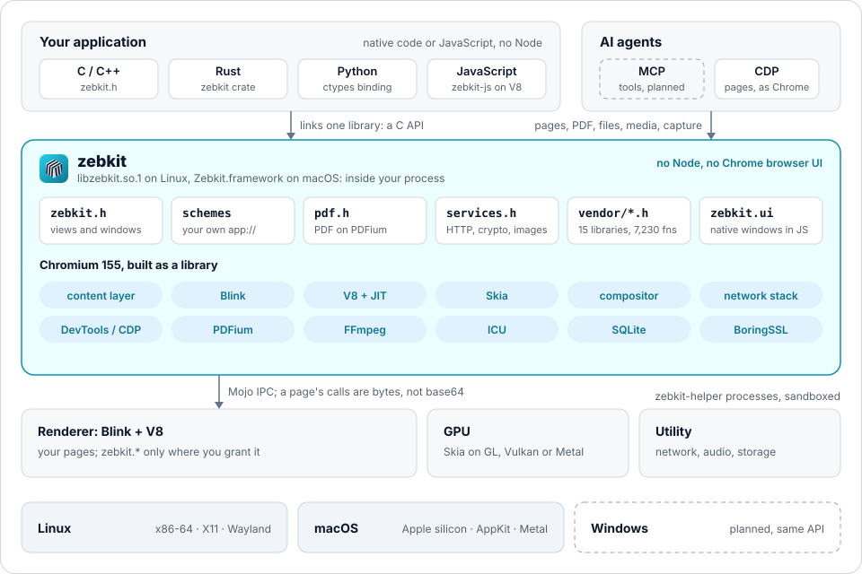

# Architecture

How zebkit is made: what runs where, and which part of this repository
does it. The API itself is `docs/API.md`.



(`scripts/architecture-svg.py` draws the picture.)

## The engine as a library

Chromium's content layer is the multi-process browser without Chrome:
navigation, the renderer processes, the GPU process, the network service,
Mojo IPC and the DevTools backend, with Blink and V8 in the renderers.
zebkit builds it as a library the application links, `libzebkit.so.1` on
Linux, `Zebkit.framework` on macOS and `zebkit.dll` on Windows, and a helper
program, `zebkit-helper` (`Zebkit Helper.app` on macOS), that the engine
starts for every child process on Linux and macOS. There the application's
own executable is never re-run as a renderer, as Electron's is. On Windows
Chromium's sandbox needs the process that starts the children and the
children to be one executable, so the application's executable, linked with
`zebkit_sandbox.lib` (`<zebkit/win_sandbox.h>`), is its own renderer, GPU and
utility processes; `zebkit-helper.exe` is used only with `--no-sandbox`
([WINDOWS.md](WINDOWS.md#the-sandbox)).

```
application process                          child processes (zebkit-helper)
+---------------------------------------+    +-----------------------------+
| the application's code                |    | renderer: Blink, V8         |
|   zebkit_main(), views, callbacks     |    |   the page, zebkit.* object |
| libzebkit: content's browser process  |<-->| GPU: viz, ANGLE, SwiftShader|
|   views and windows, navigation,      |Mojo| utility: network, audio,    |
|   DevTools server, schemes, PDFium,   |    |   storage                   |
|   zebkit.* answers, zebkit.ui (views) |    +-----------------------------+
|   V8 for zebkit-js (script outside)   |
+---------------------------------------+
```

- **Starting.** `zebkit_main()` starts the content layer as Android
  WebView does: the embedder initializes `BrowserMainRunner` and runs its
  loop, and calls the application's `ready` once views can be made. It
  returns after `zebkit_quit()`. Chromium's switches in `argv` work as for
  Chrome. The application's thread is the browser's UI thread: every
  callback runs there, and `zebkit_post_task()` reaches it from any thread.
- **Windows.** A view is a `zebkit::Window` (`src/engine/window.h`): Aura and
  Views on Linux and Windows, Cocoa on macOS, with titles, sizes and limits, and
  views attached inside another view's window, as a browser inside an
  application. Without a display, or with `--headless`, a view has no
  window and its page still loads, runs and draws (`zebkit_view_capture`). An
  off-screen view has none in any process: on Linux and macOS, windows and
  off-screen views live in one process (`tests/engine/mixed_views.c`).
- **Input methods in windows.** Chromium gets a Linux input method from its
  toolkit (GTK, Qt) or from Ozone, and zebkit has no toolkit. On X11, where
  Ozone gives none, the engine is itself a client of IBus
  (`ime_ibus_linux.cc`): ibus-daemon's own bus, which fcitx5 serves too through
  its IBus frontend, found by `IBUS_ADDRESS` or the file ibus-daemon writes.
  Composition is drawn in the page, the candidates by the input method at the
  caret; password fields are not the input method's. Without IBus running,
  keys are the page's, as before. On Wayland input methods are not done:
  Ozone's own text input is there but has not been checked, and Wayland has
  only been run in a headless compositor (`docs/ROADMAP.md`). Off-screen views
  compose through the application (`zebkit_view_ime_set_composition`).
- **The allocator.** A library must not take over the application's
  `malloc`, so PartitionAlloc does not (`use_partition_alloc_as_malloc =
  false`); Blink and V8 keep their own heaps, with the thread-local model
  a shared library needs (`patches/1011`).
- **Relocations.** The engine applies its own packed relocations when it
  is loaded (`patches/1005`), so that they work on glibc older than 2.36.
- **What it exports.** zebkit's own functions and the libraries' entry
  points under `zebkit_vendor_*`, nothing else (`src/engine/zebkit.ver`;
  `scripts/engine-test.sh` checks).

## A page's calls to the application

A page the application grants it to gets a global `zebkit`. The object is
made by a script the view's internal DevTools session adds before the
page's own (`Page.addScriptToEvaluateOnNewDocument`). Each frame's renderer
puts a native function in the page's world when its document's context is
made (`page_call_renderer.cc`); the script takes it and deletes it before
any of the page's script runs, and where there is no script the renderer
deletes it. A call goes over the frame's own Mojo channel
(`page_call.mojom`), so the browser knows the frame, and so the origin,
from the channel:

```
page script                renderer                  browser process
zebkit.app.save(...)  -->  JSON + bytes, as UTF-8 --> the frame's PageCallHost (call.cc)
                           past 64 KiB in shared      knows the frame, so its origin
                           memory, not in the         checks the grant (view.cc)
                           message                    zebkit.app: the JSON checked, not
                                                      parsed, handed to the application;
                                                      the rest parsed and done (bridge.cc,
                                                      pdf_bridge.cc) on the thread pool
<-- value, Uint8Array <---- JSON + bytes <-------------
```

- **The origin is the browser's**, from the factory of the frame that
  called, never what the page's script says. Frames of another site are
  other DevTools targets, which the view's session does not attach to, and
  never get the object.
- **Bytes are bytes.** A frame is a 32-bit length, JSON, then binary parts
  the JSON points to (`{"$part": [offset, size]}`), through Mojo's data
  pipes: no base64, and many calls under way at once.
- **PDF work is ordered by urgency.** A page's PDF calls go to one sequence
  of the thread pool with three levels: rendering and hit tests first,
  reads of one page next, bulk reads (a whole document's text) last, so a
  reader's visible page is never behind the indexing of the rest.
- **The renderer stays sandboxed.** Files, PDFs, compression and the
  network are reached in the browser process, and only what the grant
  allows.

`zebkit.app.<name>()` calls the application's own function
(`zebkit_view_bind`), with JSON arguments and result.

## URL schemes of the application's own

`zebkit_scheme_register()` makes a scheme known to every process (as
standard, secure, open to `fetch()`, past pages' CSP, as its flags say), and
`zebkit_scheme_handle()` answers it. It is Chromium's way for its own
schemes, a URL loader factory per scheme in the browser process
(`scheme.cc`, modelled on `content/browser/data_url_loader_factory.cc`), and
what Electron calls `protocol.handle`. A file is answered as it is read, in
the range a `Range` header asks for, so `<video>` seeks in local files
without a server.

## The libraries inside the engine

Chromium builds zlib, Brotli, Zstandard, BoringSSL, SQLite, LevelDB, ICU,
HarfBuzz, FreeType, libxml2, libwebp, libjpeg-turbo, FFmpeg, dav1d, Opus,
libvpx and PDFium into the engine, 17 C libraries. `src/engine/vendor/gen_vendor.py` runs at the end of the
build: a function is exposed when the library's public headers declare it
and the library's compiled objects define it. It writes an entry point
`zebkit_vendor_<library>_<function>` for each, and a header per library
that maps the library's own names to them, so another copy of the same
library in the process (the system's, the application's) is a different one
and does no harm. Chromium's own renames (zlib's `Cr_z_`, SQLite's
`chrome_sqlite3_`, ICU's version suffix) are followed. C++ libraries
(Skia, V8, `net`) are not exported: they are compiled against Chromium's
own libc++, whose types an application cannot share, and are reached
through the services instead.

FFmpeg is built with zebkit's configuration (`src/ffmpeg`, generated by
`scripts/ffmpeg-config.sh` with Chromium's own scripts, `patches/1017`):
Chrome's demuxers and decoders, plus libswresample, libswscale, the file
protocol and the MP4, MOV, Matroska and WebM muxers that applications need.

## PDF

PDFium is in the engine at the revision Chromium pins, without XFA and
without its own V8. `pdf.cc` is `<zebkit/pdf.h>` over PDFium's public API;
`pdf_internal.cc` reaches PDFium's classes where the public API does not
(an annotation's dictionary entries, nested signature fields), and
`patches/1014`, `1015` and `1020` add to PDFium what it lacked. Signatures
are checked with BoringSSL: the bytes a signature covers, its signed
attributes, and the signer's key. PDFium is not thread-safe, so every call
takes one lock.

## Script outside any page, and `zebkit.ui`

`zebkit_script_new()` makes a V8 isolate in the application's process, on
the engine's thread, with the whole of `zebkit.*` and `zebkit.View`
(`script.cc`); `tools/zebkit-js` runs an ES module with it, as Node runs
one. `zebkit.ui` builds windows of Chromium's views from that script
(`ui.cc`, `ui_script.h`): components run once, signals update the
properties that read them, and changes reach the native side as one batch
of mount operations per turn of the loop, as in Native Shell and Solid.
Layout is views' box layout (a direction, gap, padding, alignment, grow); a
web view is one widget among the others.

## CDP

The endpoint is content's own DevTools server, what Chrome serves with
`--remote-debugging-port`: `zebkit_cdp_listen()` starts it, and the
switch works as for Chrome. Puppeteer and Playwright connect to the
browser target's WebSocket address (`zebkit_cdp_get_url()`).

## Source

| Path | What it does |
|---|---|
| `src/engine/engine.cc`, `engine.h` | `zebkit_main()`, `zebkit_helper_main()`, the classes that start the engine; where its files are |
| `src/engine/engine_mac.mm` | macOS: the framework's and helper's places, the helper's sandbox, the menu bar, headless views, views on an `NSView` |
| `src/engine/engine_win.cc`, `win/sandbox_startup.cc`, `win/flatten_lib.py` | Windows: where the engine is, its arguments and child processes; `zebkit_sandbox.lib`, linked into the application's executable (`<zebkit/win_sandbox.h>`) |
| `src/engine/glibc_compat.cc` | What the engine would otherwise take from a glibc newer than 2.17 |
| `src/engine/host_loop.cc`, `startup_settings.cc` | `zebkit_init()`, `zebkit_pump()`, `zebkit_set_wakeup()` under the application's own loop; startup settings |
| `src/engine/view.cc`, `view.h` | `zebkit_view`: the window and its page, grants, bindings, the page's script |
| `src/engine/window.cc`, `window.h`, `window_platform.h`, `window_views.cc`, `window_mac.mm` | `zebkit::Window`, the engine's own embedder of a page: views' widgets on Linux and Windows, Cocoa on macOS, none for an off-screen view |
| `src/engine/window_api.cc`, `window_options.cc` | `<zebkit/window.h>`: a window made with options, its frame, state, actions, events and drag regions |
| `src/engine/attach.cc` | Views inside another view's window (Linux and Windows); `zebkit_view_attach_native()` into an X11 window or an `HWND` (macOS's is in `engine_mac.mm`) |
| `src/engine/profile.cc`, `client_defaults.cc`, `accept_language_delegate.cc`, `background_sync_controller.cc`, `protocol_handler_delegate.cc`, `protocol_handlers.cc` | `zebkit::Profile`, the browser context, and what content asks of every embedder that is not a hook of the application's |
| `src/engine/permission_manager.cc`, `permissions.cc`, `permission_types.cc` | Permissions: denied where a browser would ask, unless the application decides; the view's rules by origin |
| `src/engine/page_hooks.cc`, `navigation_hooks.cc`, `network_hooks.cc`, `certificate_hooks.cc`, `client_certificate.cc`, `http_auth.cc`, `download_hooks.cc`, `download_manager.cc`, `file_select.cc`, `file_system_access.cc`, `popup_metadata.cc` | `<zebkit/hooks.h>`: what a page asks of its window, navigation, the network at every stage, certificates and client certificates, HTTP authentication, downloads, file choosers and File System Access, popups (`docs/ROADMAP_HOOKS.md`) |
| `src/engine/settings.cc`, `runtime_settings.cc` | A view's preferences and the settings changed while the engine runs |
| `src/engine/js_dialog_manager.cc`, `js_dialog_views.cc`, `js_dialog_mac.mm`, `sign_in_dialog*.cc`, `certificate_picker*`, `context_menu*` | The defaults where there is a window: JavaScript dialogs, HTTP sign-in, the client certificate list, the context menu (`docs/SYSTEM_INTEGRATION.md`) |
| `src/engine/appearance.cc`, `notifications*`, `tray*`, `dock*`, `desktop_actions*`, `share*`, `device_choosers.cc`, `system_events.cc`, `surfaces.json` | System integration: the system's appearance, notifications, the tray, the Dock and taskbar, opening URLs and folders, sharing, device choosers, power and displays; `surfaces.json` is the registry `scripts/check-surfaces.py` checks |
| `src/engine/ime_ibus_linux.cc` | An input method in X11 windows, over IBus |
| `src/engine/cookies.cc`, `cookies_mac.mm`, `cookies_win.cc`, `cookie_key_file.cc` | Cookies kept in the profile, and their key on each system or in a file (`docs/COOKIE_PERSISTENCE.md`) |
| `src/engine/webauthn.cc`, `webauthn_views.cc`, `webauthn_mac.mm`, `automation_webauthn.cc` | WebAuthn and passkeys through the application's UI or a default one (`docs/PASSKEYS.md`); Playwright's virtual authenticator |
| `src/engine/chrome_object.cc`, `client_hints.cc` | `window.chrome` and client hints as Chrome has them |
| `src/engine/offscreen.cc`, `offscreen_mac.mm` | `<zebkit/offscreen.h>`: views drawn off-screen, their frames from viz's video capturer, their input (through the page's input event router, to the frame under the mouse and the focused frame: `patches/1077`), popups and cursor (from `patches/1021`'s hooks) |
| `src/engine/dialog.cc`, `print.cc`, `drag.cc`, `devtools.cc`, `page_internal.h` | `<zebkit/page.h>`: JavaScript dialogs held for the application or a CDP client; printing to PDF as headless Chrome prints, and `Page.printToPDF`; drags from the page (from `patches/1024`'s hook) and into it; the DevTools manager delegate |
| `src/engine/media_capture.cc`, `media_capture_renderer.cc`, `media_capture_writer.cc`, `media_capture.mojom` | `<zebkit/media.h>`: each frame's media elements and a tap on a player's demuxer (renderer, from `patches/1031`, `1032`), the packets kept and written into files by FFmpeg's muxers (browser) |
| `src/engine/media_tap.cc`, `media_tap_renderer.cc` | `<zebkit/media_tap.h>`: decoded frames and sound as a page plays them (`docs/MEDIA_TAP.md`) |
| `src/engine/media_tools.cc` | `<zebkit/media_tools.h>`: probing, remuxing and extracting with the engine's FFmpeg (`docs/MEDIA_TOOLS.md`) |
| `src/engine/automation.cc`, `automation_renderer.cc`, `automation_steps.js`, `automation.mojom`, `automation_network.cc`, `automation_context.cc`, `automation_trace.cc`, `automation_server.cc`, `automation_scripts.py`, `playwright/` | `<zebkit/automation.h>`: Playwright's commands natively (`docs/AUTOMATION.md`): each frame's and worker's agent with Playwright's injected script in an isolated world, input to the widgets, routes in front of the network (WebSockets too), contexts as profiles of their own, traces, HAR and video, frames on demand, and Playwright's own protocol over a WebSocket for its clients (`zebkit_automation_listen`) |
| `src/engine/call.cc`, `call.h`, `page_call_renderer.cc`, `page_call.mojom` | The page's calls and their answers over each frame's channel: JSON and bytes, through shared memory when large; `zebkit.app`'s JSON checked and passed on without being parsed |
| `src/engine/bridge.cc` | What `zebkit.*` calls do once the browser has checked them |
| `src/engine/pdf.cc`, `pdf_internal.cc`, `pdf_bridge.cc`, `pdf_script.h` | `<zebkit/pdf.h>`, PDFium's classes, `zebkit.pdf` and its queue |
| `src/engine/pdf_appearance.cc`, `pdf_interchange.cc`, `pdf_hooks.cc` | Annotations' appearance streams, XFDF and FDF, the PDF hooks |
| `src/engine/pdf_viewer_renderer.cc`, `pdf_viewer.js`, `pdf_viewer_script.py` | PDF in pages: Chromium's viewer plugin with zebkit's small viewer in place of Chrome's extension |
| `src/engine/canvas.cc`, `text.cc` | `<zebkit/canvas.h>` on Skia (and as PDF operators for appearances), `<zebkit/text.h>` on HarfBuzz |
| `src/engine/scheme.cc`, `scheme.h` | The application's URL schemes |
| `src/engine/services.cc` | `<zebkit/services.h>` |
| `src/engine/script.cc` | Script outside any page |
| `src/engine/ui.cc`, `ui.h`, `ui_script.h` | `zebkit.ui` |
| `src/engine/app.cc`, `app.h` | The application's menu, opened files, reopen and quit |
| `src/engine/cdp.cc` | The DevTools endpoint |
| `src/engine/helper.c` | `zebkit-helper` |
| `src/engine/vendor/gen_vendor.py` | The libraries' entry points and headers |
| `src/engine/include/zebkit/` | The public headers |
| `src/engine/BUILD.gn` | The library, the helper, the framework; linked into Chromium's tree as `//zebkit/engine` |
