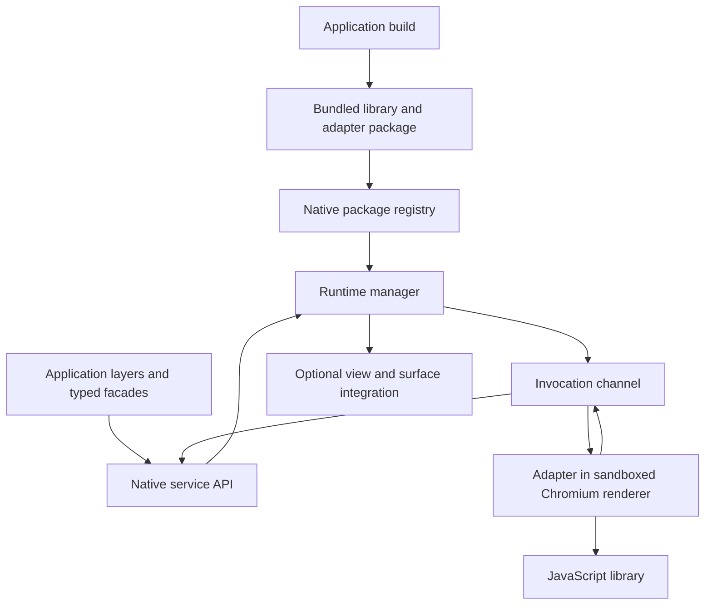

# JavaScript libraries as native services

Status: architecture proposal for review. No implementation or API commitment.

## Purpose

Allow an application to bundle a JavaScript library, register it with zebkit,
and expose selected functionality to the rest of the application through a
native API. The library continues to execute as JavaScript in Chromium; callers
use operations and values without managing a page, injecting JavaScript, or
knowing the library's browser-side implementation.

This is a general extension mechanism. Charting, document conversion, layout,
parsing, and other browser-compatible libraries should share the same loading,
invocation, and lifecycle infrastructure. ECharts is one example, not a built-in
dependency or a special engine API.

Here, registering with “Chrome” means registering with zebkit's embedded
Chromium runtime. It does not require a system Chrome installation, a Chrome
extension, or additions to the compatibility object `window.chrome`.

The intended division of work is:

| Participant | Responsibility |
|---|---|
| Application integrator | Select and build libraries, write adapters, bundle assets, register packages, choose resource and access policies |
| zebkit | Load packages, host execution, route calls and results, enforce boundaries, manage lifetime and failure |
| Other application layers | Consume application-defined operations through C or language wrappers |

An application can publish a typed facade such as `Charts.render_svg(options)`
or `Documents.convert(input)`. Those facades belong to the application or an
adapter package. zebkit provides the common mechanism underneath them.

## Existing foundation and missing abstraction

The repository already supplies several relevant pieces:

| Existing facility | What can be reused | What it does not provide |
|---|---|---|
| [`zebkit_view_evaluate()`](../src/engine/include/zebkit/zebkit.h) and [`view.cc`](../src/engine/view.cc) | Execute page JavaScript and await promises | A registered, validated operation interface or managed library lifetime |
| [`zebkit_view_bind()` and grants](API.md#4-javascript-in-the-page) | Authorized page-to-application calls | Native-to-library dispatch or package-specific capabilities |
| [`page_call.mojom`](../src/engine/page_call.mojom), [`call.cc`](../src/engine/call.cc) | Frame-bound identity, JSON plus binary parts, large buffers through shared memory | The reverse invocation protocol and library instance tracking |
| [`scheme.cc`](../src/engine/scheme.cc) | Serve bundled resources through Chromium's resource loader | A package resolver and package access policy |
| [`zebkit_script_*`](API.md#script-outside-any-page) and [`script.cc`](../src/engine/script.cc) | Host-process V8 and file-based ES modules | Blink's DOM, renderer isolation, or a restricted library-service environment |
| [`offscreen.h`](../src/engine/include/zebkit/offscreen.h) | Frame delivery, input, size and scale for interactive content | A general JavaScript library service |

The new abstraction should compose these capabilities without requiring each
application to build its own loader, protocol, object registry and crash handling.
Unlike the existing [native media tools](MEDIA_TOOLS.md), a renderer-backed
JavaScript service requires engine initialization and a running engine loop.

## Architecture



Separate five concerns:

1. **Package.** Immutable code, resources, identity and a declared interface.
2. **Registration.** An application-owned catalog of packages available to this
   engine session. Registration does not execute library code.
3. **Instance.** A running adapter and its private library state. One package can
   have several independent instances.
4. **Invocation.** An asynchronous, versioned exchange of operation names, data,
   results and errors across a process boundary.
5. **Presentation.** Optional ownership of a web view or rendered surface when a
   library produces interactive content. Presentation is separate from calling
   functions and returning data.

The registry and runtime manager live in zebkit's browser process. Library code
runs in a renderer. Native callers never receive V8 objects, DOM nodes or raw
renderer pointers. An instance is independent of ordinary browsing tabs and
their navigation.

## Package and adapter contract

The application builds third-party source into browser-compatible JavaScript
before shipping. “Compiled JavaScript” here means a bundled/minified JavaScript
artifact, not machine code or portable V8 bytecode. npm, transpilation,
dependency resolution and tree shaking remain build-time responsibilities.
The runtime does not install packages or download code from a CDN.

A package contains:

```text
app-resources/libraries/charting/
  library.json
  adapter.mjs
  vendor/echarts.mjs
  assets/...
  LICENSES/...
```

Illustrative manifest; these fields are proposed:

```json
{
  "manifestVersion": 1,
  "id": "com.example.charting",
  "version": "1.0.0",
  "interfaceVersion": 1,
  "runtime": "document",
  "entry": "adapter.mjs",
  "exports": ["renderSvg"],
  "capabilities": []
}
```

`version` identifies the application package, including its adapter and vendored
dependencies. `interfaceVersion` identifies the operations callers consume;
`manifestVersion` identifies the packaging contract. These are independent of
the private wire protocol version and the third-party library's version.

Registration accepts an application-supplied local package root or resource
provider. Disk directories can be the first implementation; archive and
in-memory providers can follow the same resolver contract. Imports and resources
must resolve within that package. Reject missing files, unsupported versions,
duplicate identities, traversal and symlink escapes. Capture a stable package
snapshot so validation and execution cannot observe different files. Exact
snapshot storage is an implementation choice; retaining unchecked mutable paths
is insufficient.

Use ES modules for the adapter contract. UMD, CommonJS and libraries with Node
dependencies need build-time conversion or an adapter-provided compatible
implementation. There is no implied Node.js runtime, native npm addon support,
or guarantee that every npm package works. Libraries using optional browser
features must declare requirements and fail explicitly if the engine profile
does not support them.

The adapter exports a factory. The factory returns a closed table of operations
plus optional lifecycle hooks kept separately from that table:

```javascript
// Illustrative contract, not an existing zebkit module.
import { convert } from './vendor/converter.mjs';

export default async function createLibrary(host) {
  return {
    operations: {
      async convertDocument(args, call) {
        // Validate the application's input contract here.
        // call.signal supports cooperative cancellation.
        return convert(args.input, { signal: call.signal });
      }
    },
    async dispose() {
      // Release library-owned state and listeners.
    }
  };
}
```

The runner verifies that declared exports exist and are callable own properties
of `operations`; calls cannot name arbitrary globals, property paths or lifecycle
hooks. An adapter defines meaningful operations rather than exposing every
method of a JavaScript object. It handles library-specific initialization,
argument validation, errors, cleanup and conversion to transferable data.

`host` exposes only explicitly granted services and, where supported, an event
emitter. It is not the full privileged host-process `zebkit.*` object. Function
options, formatters and plugins supplied as JavaScript must be bundled into the
adapter; consumers do not send source code or callbacks across the boundary.

## Execution environments

The initial backend should be a sandboxed renderer document with Blink and V8.
It supports libraries that use the DOM, Canvas, SVG, fonts and layout, as well as
libraries that only calculate and return data. Choosing this common environment
avoids making a library's accidental use of a browser API an architectural
exception.

A service document should have its own browser-owned WebContents and lifetime,
with no user navigation or application window. For data-only work it needs no
frame streaming. This is a new internal host, not a promise that hiding an
existing view preserves every browser behavior. Explicit dimensions, visibility,
timer throttling, font readiness and rendering completion need defined policies
when adapters depend on them.

The architecture leaves room for additional backends:

| Backend | Appropriate workload | Constraint |
|---|---|---|
| Renderer document, initial | General browser libraries and libraries needing DOM/layout | Renderer startup and memory cost |
| Renderer worker, future | DOM-free computation and transferable data | No document APIs; library must declare compatibility |
| Restricted V8 or utility runtime, future | Pure JavaScript with a smaller environment | Separate security and scheduling design; not the existing privileged host-script isolate |

Runtime selection is explicit and capability checked. Do not silently move a
package between environments. The public invocation contract should remain the
same as backends evolve.

Each instance owns a separate document, origin and ephemeral storage scope.
Separate JavaScript state is not a guarantee of a separate OS process:
Chromium process allocation must be treated explicitly. The runtime manager
tracks all instances sharing a renderer and invalidates all of them on failure.
A future dedicated-process mode can offer a stronger failure boundary after
verification; it should not be implied by the word “instance.”

## Native invocation and data model

Provide an additive C API, tentatively in `<zebkit/library.h>`, and expose it
through the existing Rust, Python, Go and host-JavaScript bindings. Names below
describe proposed operations rather than signatures available today:

| Operation | Contract |
|---|---|
| `zebkit_library_register` | Validate and retain an immutable package; return a package handle or registration error |
| `zebkit_library_create` | Create an instance and asynchronously report readiness after adapter initialization |
| `zebkit_library_call` | Invoke one declared operation with data and a deadline; return a request ID |
| `zebkit_library_cancel` | Request cancellation of an accepted invocation |
| `zebkit_library_destroy` | Stop accepting work, settle pending work and dispose the instance |
| `zebkit_library_unregister` | Remove a package; reject while instances still reference it |

Conceptual consumer flow, deliberately pseudocode:

```text
package = register(app_resources / "libraries/document-tools/library.json")
instance = await create(package)
result = await instance.call("convertDocument", {input: document_bytes})
await instance.destroy()
unregister(package)
```

A typed application wrapper maps this to ordinary application methods. It can
check the package's interface version and translate results into language types.
Calls remain asynchronous even when the JavaScript operation is synchronous.
The API does not make JavaScript functions into synchronous C function pointers.

Use a deliberately bounded value model:

- JSON-compatible values: null, booleans, finite numbers, UTF-8 strings, arrays
  and records. Define a nesting limit and reject unsupported values.
- Binary buffers as separate parts, represented as `Uint8Array` in the adapter
  and pointer/length buffers in C. Reserve and validate transport marker keys.
- No implicit serialization of functions, DOM objects, promises, cyclic graphs,
  `BigInt`, non-finite numbers or arbitrary class instances. Adapters normalize
  these explicitly. Await an operation's promise before encoding its result.
- Stateful library objects stay in the instance. Adapters can issue opaque
  instance-scoped IDs with explicit release operations; those IDs become invalid
  on disposal or restart. They convey no native memory access.

Reuse the JSON-plus-binary framing and `mojo_base.mojom.BigBuffer` approach of
`page_call.mojom`. Large transfers may use shared memory; that does not establish
an end-to-end zero-copy guarantee. The new API must define input-copy and output
ownership rules: inputs are borrowed only until the API returns; result data is
borrowed for the callback unless explicitly retained or copied. No base64 is
needed for binary payloads.

Every accepted request gets exactly one terminal completion with either a value
or a structured error. Define stable codes for invalid arguments, unknown
operation, unsupported capability, JavaScript failure, serialization failure,
timeout, cancellation, overload, closed instance and renderer loss. A request
rejected before acceptance returns an immediate error and schedules no completion.
Diagnostics can include package, instance, operation, request ID and an optional
JavaScript stack; callers branch on codes rather than exception text.

## Transport, scheduling and lifetime

Introduce a browser-to-renderer invocation channel and a renderer-side runner.
The existing `PageCallHost` is page-to-browser; it cannot simply be called
backwards. Reuse its framing and identity principles, with new messages for
initialization, invocation, completion, cancellation and disposal.

Bind the channel to the browser-created service frame and an instance generation.
The browser validates every request and response against the package interface,
request table and size limits. Identity comes from the channel, not an instance
ID asserted by JavaScript. Never build executable strings from operation names
or arguments. A prototype may use internal DevTools machinery, but the public
contract should not depend on arbitrary evaluation or an exposed debugging port.
In particular, `zebkit_view_evaluate()` currently grants a user gesture; service
calls must not inherit that privilege.

Suggested lifecycle:

```text
Package:  unregistered -> registered -> unregistered
Instance: starting -> ready -> closing -> closed
                    |           ^
                    +-> failed -+
          starting may also fail or be closed
```

Calls require `ready`; a convenience wrapper can wait for readiness. Registration
does not initialize an instance. Initialization failure is reported asynchronously
and does not remove the registered package. Create another instance to retry.
No hot replacement: new versions use new registrations and instances.

Follow zebkit's existing threading model: management and invocation occur on the
engine thread, callbacks return there, and other application threads use
`zebkit_post_task()`. Bindings may provide futures or awaitables without blocking
that thread. Delivery is deferred so user callbacks do not run inline inside
the initiating call.

Serialize operation execution per instance initially, awaiting each operation
before starting the next. This gives stateful adapters predictable ordering.
Independent instances can progress concurrently. Enforce bounded queue length,
payload size and deadlines; reject overload instead of allocating indefinitely.
No synchronous wait may pump the engine recursively. Adapter-to-host services
must also be asynchronous and must not wait on another call queued behind the
currently running operation in the same instance.

Cancellation is cooperative while code is running. A deadline stops native
waiting and ignores late replies, but does not roll back side effects or safely
preempt arbitrary JavaScript. Do not start the next serialized operation while
the timed-out operation is still executing. If it cannot settle promptly, fail
and tear down the instance; termination may affect other instances sharing its
renderer. A wedged renderer needs a browser-side watchdog and an explicit
process termination policy, not just a timer in JavaScript.

Destroy rejects queued work, cancels active work, attempts adapter cleanup with
a bounded grace period, then removes the frame and its resources. Completions
must finish before destruction is acknowledged; afterward no callback may use
the instance's application data. Native handles stay valid until that closing
completion. Renderer loss invalidates pending calls, object IDs, subscriptions
and surfaces. Recovery is explicit recreation; automatic replay is unsafe for
operations with side effects. Engine shutdown drains or fails outstanding work
before destroying callback state.

## Optional presentation and events

Some libraries return values; others maintain interactive visual objects.
Both use the same package and invocation model, but only the latter require
presentation. Define presentation as an optional capability with a separate
view/surface attachment contract, not as a requirement of every library.

For interactive use, keep the library and its DOM in an owned renderer view.
The host composes that view or consumes off-screen frames, supplies dimensions
and device scale, and forwards input and focus using the existing facilities.
The adapter owns library-specific resize and disposal. Returning a native
handle does not convert the result into a native toolkit widget.

Reuse existing platform limits honestly: `offscreen.h` currently requires a
headless process for Windows off-screen views, and non-headless Wayland
off-screen views are unavailable. General service calls returning data should
not depend on that frame-streaming API. Presentation support needs a capability
query and platform validation rather than assuming every runtime can attach an
interactive surface.

Events are an optional later protocol extension: explicit subscriptions, declared
event names, data-only payloads, unsubscribe, and bounded delivery. Define
ordering relative to calls and how events are coalesced or dropped under
backpressure. Never send raw DOM event objects or call native callbacks
synchronously from a renderer. Disposal ends subscriptions.

## Access and resource boundaries

Application-native code is the registration authority. Ordinary pages and remote
content cannot register packages or obtain arbitrary instances. If an application
later exposes selected library operations to a page, it does so through explicit
bindings and origin checks, retaining the same narrow operation interface.

Load code and assets through a private package resource loader, with a distinct
origin and ephemeral storage scope per instance. Do not reuse the user's browsing
profile or expose its cookies. Do not grant `ZEBKIT_ALLOW_ALL`, file access, or
the existing privileged network API to library documents by default.

Default policy permits package resources and denies external network, navigation,
popups, downloads, device access and native host services. Enforce restrictions
in the browser, including requests initiated by images, CSS, workers and other
subresources; a JavaScript wrapper around `fetch` is insufficient. Use CSP as an
additional boundary without `bypass-csp`, `eval`, or remote scripts. Any future
grants must be explicit and constrained to the required resources and services.

Set limits for package size, instances, queue depth, input/output buffers and
operation duration. Memory ceilings and failure containment depend on the chosen
process model; do not promise a hard per-instance heap limit inside a shared
renderer. Bundled libraries still need dependency updates and license notices.
The registry is an application integration mechanism, not an untrusted plugin
marketplace.

## ECharts as an example

An application can bundle ECharts and export `renderSvg({width, height, option})`.
The adapter validates dimensions and options, creates a temporary chart, returns
the SVG string, and disposes it in `finally`. Callers see a chart-rendering API;
they do not load HTML or write evaluation strings.

ECharts documents an SVG SSR path using `echarts.init(null, null, {renderer:
'svg', ssr: true, width, height})` followed by `renderToSVGString()`. This is a
useful data-returning operation with no interactive surface. Such an adapter
can disable animation for static exports and control fonts and assets for
repeatable output. The runtime and adapter must be tested with the application's
pinned ECharts build. See the [official SSR guide](https://echarts.apache.org/handbook/en/how-to/cross-platform/server/).

For interactive charts, the adapter instead creates a sized DOM container and
exports operations such as `createChart`, `setOption`, `resize` and
`disposeChart`. The view handles rendering and input; optional subscriptions
translate selected chart events into application data. ECharts requires usable
container dimensions and explicit resizing and disposal, as described in its
[container lifecycle guide](https://echarts.apache.org/handbook/en/concepts/chart-size/).

These examples use the same registry and call machinery as a nonvisual parser
or converter. Neither generic engine code nor the wire protocol should contain
ECharts-specific operation names.

## Implementation boundaries and validation

Suggested implementation areas, all additions rather than existing features:

| Area | Likely location |
|---|---|
| Public C contract and native handle lifetime | `src/engine/include/zebkit/library.h`, new `library.cc` |
| Package validation, registry and private resource resolver | New library package/loader modules; reuse resource-loading patterns in `scheme.cc` |
| Renderer host, lifecycle and process failure tracking | New library runtime modules using Chromium WebContents |
| Invocation channel and renderer runner | New library Mojo interface and renderer agent; reuse `page_call.mojom` framing patterns |
| Existing language bindings | `bindings/rust/`, `bindings/python/`, `bindings/golang/`, host API in `script.cc` |
| Optional presentation | Existing view/off-screen facilities plus a narrow ownership adapter |

Implement in reviewable stages:

1. Finalize the package, instance, call, error and ownership contracts. Prototype
   a renderer service document on Linux, macOS and Windows without a native
   window. Check sandboxing, startup, idle scheduling and orderly shutdown.
2. Implement local immutable packages, registration, asynchronous creation,
   declared operations, JSON and binary values, bounded dispatch and failure
   handling. Validate with both a pure-data adapter and a DOM-dependent adapter.
3. Expose the same operations in all existing bindings and add application-side
   wrapper examples. ECharts SVG export can be one example among several.
4. Add presentation and event subscriptions when required. Add worker backends,
   pooling or generated typed wrappers only after measuring actual workloads.

Acceptance criteria should cover offline loading; invalid packages and exports;
multiple libraries and isolated instances; non-ASCII JSON and large binary
round trips; promise rejection and serialization failure; queue overload;
initialization failure; cancellation and timeout without accidental concurrent
mutation; renderer termination; destruction with calls pending; shutdown;
resource access denial; and absence of unintended browser-profile access.
Presentation needs separate resize, scale, input, cleanup and platform tests.

Measure cold instance creation, warm call latency, serialization and binary
transfer costs, per-instance memory, idle CPU and sustained rendering behavior.
Compare with equivalent application-managed views before selecting pooling or
a lighter runtime. No performance improvement or measurement is claimed here.

## Decisions for architecture review

The proposed baseline is a generic native service API, app-bundled immutable
packages, explicit adapters, asynchronous data exchange and sandboxed renderer
execution. The following choices remain open before implementation:

- Whether the first package provider is directory-only or also supports embedded
  application resources, and how immutable snapshots are retained.
- Which quotas are configurable initially, and whether applications need a
  dedicated renderer process for selected services.
- Whether presentation and event subscriptions are needed in the first release
  or can follow the data-returning service API.
- Whether schema-driven typed facade generation belongs in zebkit tooling or
  stays with application-owned adapters.

None of these choices require a special integration path for a particular
JavaScript library.
