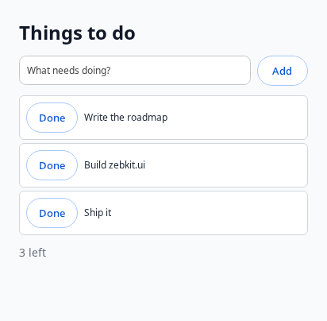

# zebkit's API on Blink

What an application gets from the engine: the plan is section 7 of
`docs/blink/ROADMAP.md`; this is what is built. The engine is
`libzebkit.so.1`, with `zebkit-helper` beside it for the renderer, GPU and
utility processes, and the headers in the package's `include/`.

```sh
cc app.c -I<package>/include -L<package> -l:libzebkit.so.1 -Wl,-rpath,<package>
```

| Layer | Header | What |
|---|---|---|
| 0. Core | `<zebkit/zebkit.h>` | Start the engine, run its loop, views, script in pages and outside them, native interface (`zebkit.ui`), CDP, calls between the page and the application |
| 1. Libraries | `<zebkit/vendor/<library>.h>` | The C libraries inside the engine, with their own APIs |
| 2. Services | `<zebkit/services.h>`, `<zebkit/pdf.h>` | Compression, cryptography, URLs, images, ICU's data, HTTP, PDF, over Chromium's own code |
| 3. Bindings | `bindings/python/zebkit` | Layers 0 and 2 for Python |
| 4. JavaScript | `zebkit.*` in a page | Layers 0 and 2 for the page's script, as the application grants it |

`scripts/engine-test.sh <profile>` tests every layer from programs built
against the package (`tests/engine/`).

## 0. The core

```c
#include <zebkit/zebkit.h>

static void loaded(zebkit_view *view, zebkit_load_event event, const char *url, void *data) {
    if (event == ZEBKIT_LOAD_FINISHED)
        zebkit_view_evaluate(view, "document.title", printed, NULL);
}

static void ready(void *data) {
    zebkit_view *view = zebkit_view_new("https://example.com/", 1024, 768);
    zebkit_view_on_load(view, loaded, NULL);
}

int main(int argc, char **argv) {
    return zebkit_main(argc, argv, ready, NULL);
}
```

- **One call starts and runs the engine.** `zebkit_main()` starts
  Chromium's content layer the way Android WebView does
  (`BrowserMainRunner` initialized by the embedder), calls `ready` on the
  main thread when views can be made, and returns after `zebkit_quit()`.
  Closing the last window does not end it: that is the application's to
  act on. Chromium's switches in `argv` are
  honoured: `--remote-debugging-port`, `--user-data-dir`, `--no-sandbox`,
  `--headless`, `--enable-logging=stderr` and the rest.
- **Threads.** Everything is for the thread that called `zebkit_main()`,
  and every callback runs on it; `zebkit_post_task()` is for any thread.
- **Windows.** A view has a window when there is a display (Wayland or
  X11) and none otherwise; it loads, runs and can be driven over CDP
  either way.
- **Script.** `zebkit_view_evaluate()` runs script in the page and calls
  back with its value as JSON, a promise waited for, or with the message of
  what was thrown. It is Chrome's `Runtime.evaluate`, through an internal
  DevTools session of the view.
- **CDP.** `zebkit_cdp_listen()` serves the Chrome DevTools Protocol from
  Chromium's own DevTools server, which is what Chrome serves with
  `--remote-debugging-port`; `zebkit_cdp_get_url()` is the browser
  target's WebSocket address for Puppeteer and Playwright.
- **Data.** The profile is in `--user-data-dir`, by default
  `$XDG_CONFIG_HOME/zebkit/<program name>`
  (`~/Library/Application Support/zebkit/<program name>` on macOS). The
  log goes to stderr.
- **URL schemes of the application's own.** `zebkit_scheme_register()`,
  before `zebkit_main()`, makes `app:` (say) a scheme of the engine's in
  every process: standard (an origin, relative URLs), secure, open to
  `fetch()`, past pages' Content-Security-Policy, as its flags say.
  `zebkit_scheme_handle()` answers its requests, page loads, subresources,
  `fetch()` and media alike: `zebkit_request_respond()` with a status,
  headers and a body, from any thread, or `zebkit_request_respond_file()`
  with a file read as it is sent, in the range a `Range` header asks for, as
  a `<video>` seeking asks. This is Chromium's way for its own schemes (a
  URL loader factory per scheme in the browser process), and Electron's
  `protocol.handle`. The same from the command line:
  `--zebkit-scheme=app,standard,secure,fetch`.
- **The application.** `zebkit_app_set_menu()` takes the application's
  menu as JSON: items with an id, which the application's function gets,
  standard roles (undo, copy, minimize, quit, ...), submenus and
  separators, each with a key. On macOS it is the menu bar (a first
  `appMenu` menu is the application menu); on Linux and Windows, whose
  windows have no menu bar, the same keys, with Ctrl for ⌘, work in the
  application's windows when the page does not take them.
  `zebkit_app_on_open_files()` gets the files the system opens with the
  application (the Finder, the Dock), `zebkit_app_on_reopen()` the Dock
  icon clicked with no window shown, and `zebkit_app_on_quit_request()`
  ⌘Q and logging out, to quit (`zebkit_quit()`) or not. In Rust
  `zebkit::app`; in Python `zebkit.app_*`.

## 1. The libraries inside the engine

The application includes the library's header and writes the library's own
API. Every function is exported from the engine as
`zebkit_vendor_<library>_<function>`, and the header maps the one name to
the other, so the engine exports none of the libraries' own names: another
copy of a library in the process, a system one or the application's, is a
different one and does no harm. In C++ the API is also in the namespace
`zebkit::vendor::<library>`.

```c
#include <zebkit/vendor/sqlite.h>
#include <zebkit/vendor/zstd.h>

sqlite3 *db;
sqlite3_open("app.db", &db);
size_t size = ZSTD_compress(out, capacity, data, length, 19);
```

| Library | Header | Functions | Notes |
|---|---|---:|---|
| zlib | `zlib.h` | 88 | Chromium's fork, with its SIMD |
| Zstandard | `zstd.h` | 68 | Compression and decompression |
| Brotli | `brotli.h` | 32 | Encoder and decoder |
| BoringSSL | `boringssl.h` | 2,960 | `libcrypto` and `libssl`; its C++ helpers are left out (`BORINGSSL_NO_CXX`) |
| SQLite | `sqlite.h` | 263 | Built as Chromium builds it: call `sqlite3_initialize()` first (no automatic initialization); exclusive locking by default (`PRAGMA locking_mode=NORMAL` to share a file); no JSON functions, no extensions |
| ICU | `icu.h` | 955 | The C API; call `zebkit_icu_init()` first when the engine is not running. Its data is English, Chinese, Japanese and Korean |
| HarfBuzz | `harfbuzz.h` | 484 | Shaping, OpenType tables, subsetting |
| libxml2 | `libxml.h` | 1,008 | XML and HTML parsing, the tree, XPath, the reader and writer |
| libwebp | `libwebp.h` | 105 | Decoding, encoding, demuxing, muxing |
| libjpeg-turbo | `libjpeg.h` | 63 | The libjpeg API |
| FFmpeg | `ffmpeg.h` | 610 | zebkit's configuration (`src/ffmpeg`, `scripts/ffmpeg-config.sh`): Chrome's demuxers and decoders, and for applications libswresample, libswscale, the file protocol, the MP4, MOV, Matroska and WebM muxers, VP8 and VP9 through the engine's libvpx; no encoders |
| dav1d | `dav1d.h` | 19 | AV1 decoding |
| Opus | `opus.h` | 71 | Encoding and decoding |
| libvpx | `libvpx.h` | 36 | VP8 and VP9, decoding and encoding |
| PDFium | `pdfium.h` | 468 | Chromium's, without XFA forms and its JavaScript; call `FPDF_InitLibrary()` first, or use `<zebkit/pdf.h>` |

7,230 functions in all, and the engine exports nothing else but zebkit's
own API (`scripts/engine-test.sh` checks both). Only the headers the
library's header reaches are shipped, not the library's internals.

What is there is what the engine is built with: a function is exposed when
the library's public headers declare it and the library's compiled objects
define it. `src/engine/vendor/gen_vendor.py` finds them in the build, at
the end of it, and writes the entry points and the headers; nothing is
listed by hand. Chromium renames some libraries' functions (zlib's
`Cr_z_`, SQLite's `chrome_sqlite3_`, ICU's version suffix,
libjpeg-turbo's `chromium_`) with macros in their headers; the generator
follows them. FreeType is not there yet: its headers include one another
through macros, which the package's layout cannot follow.

## 2. Services

`<zebkit/services.h>`: plain functions over Chromium's own code, for what
is not one library's API.

| Functions | What | From |
|---|---|---|
| `zebkit_compress`, `zebkit_decompress` | gzip, zlib, raw deflate, Brotli, Zstandard; a limit against data that expands without end | zlib, Brotli, Zstandard |
| `zebkit_digest_compute`, `zebkit_hmac`, `zebkit_random_bytes`, `zebkit_aes_gcm_seal`, `zebkit_aes_gcm_open` | SHA-1 and SHA-2, HMAC, secure random bytes, AES-GCM | BoringSSL |
| `zebkit_url_get`, `zebkit_url_registrable_domain` | A URL parsed and canonicalized as a browser does, its parts and origin; the registrable domain by the public suffix list | `url/`, `net/` |
| `zebkit_image_decode`, `zebkit_image_encode` | PNG, JPEG and WebP to and from RGBA | `ui/gfx/codec`, libwebp |
| `zebkit_icu_init` | ICU's data, for layer 1's ICU without the engine | `base/i18n` |
| `zebkit_fetch` | An HTTP request through the engine's network stack: HTTP/1.1, 2 and 3, its cache, cookies and proxy settings, without CORS | The network service |

All but `zebkit_fetch()` work without the engine running.

### PDF

`<zebkit/pdf.h>` is documents on Chromium's own PDFium, which is in the
engine (without XFA forms and without PDFium's JavaScript). What it covers
is measured against EmbedPDF's viewer (`docs/blink/ROADMAP.md`, section 8).

```c
zebkit_pdf *pdf = zebkit_pdf_open_file("report.pdf", NULL, &error);
char *info = zebkit_pdf_info(pdf);                      /* JSON: pages, metadata, permissions */
zebkit_pdf_render_options tile = {.scale = 2, .background = 0xffffffff,
                                  .x = 0, .y = 0, .width = 512, .height = 512};
uint8_t *rgba = zebkit_pdf_render(pdf, 0, &tile, &width, &height, &error);
char *found = zebkit_pdf_search(pdf, "revenue", 0, 0, 100, &error);
int index = zebkit_pdf_annotation_add(pdf, 0, "{\"type\": \"highlight\", \"rect\": [...], \"quads\": [[...]]}", &error);
uint8_t *bytes = zebkit_pdf_save(pdf, ZEBKIT_PDF_SAVE_INCREMENTAL, &size, &error);
```

| Functions | What |
|---|---|
| `zebkit_pdf_open`, `_open_file`, `_close`, `_save` | Bytes or a file, a password; saved whole or incrementally, with or without its encryption |
| `zebkit_pdf_info`, `_set_metadata` | Pages, version, encryption, permissions, form type, language, the document information |
| `zebkit_pdf_page_count`, `_page` | A page's size as shown, rotation, label and boxes |
| `zebkit_pdf_render` | RGBA at a scale and rotation, the whole page or a tile, with annotations and form fields, on a background |
| `zebkit_pdf_text`, `_text_layout`, `_text_rects`, `_char_at` | The text; each character's box, font, size and angle; selection rectangles; hit testing |
| `zebkit_pdf_search` | Every match in the document, with its rectangles and the text around it |
| `zebkit_pdf_outline`, `_links` | Bookmarks, link annotations and addresses written in the text |
| `zebkit_pdf_annotations`, `_annotation_add`, `_update`, `_remove`, `zebkit_pdf_flatten` | Every kind read; highlights, underlines, squiggles, strikeouts, ink, lines, polygons, polylines, squares, circles, notes, free text, links and redaction marks made, changed and removed, with their appearances generated |
| `zebkit_pdf_redact` | What is under the page's redaction marks, or areas given, taken out for good: text character by character, image pixels blacked out, paths and annotations that reach in; boxes drawn over |
| `zebkit_pdf_form_fields`, `_form_set`, `_form_reset` | Every field with its type, value, options and widgets; a value set, check boxes and radio buttons by export value, with the appearance redrawn; the form reset |
| `zebkit_pdf_page_rotate`, `_pages_delete`, `_pages_move`, `_page_insert`, `_pages_import`, `zebkit_pdf_new` | Pages turned, deleted, moved, inserted blank, copied in from another document; a new document to build from others' pages (merge, extract) |
| `zebkit_pdf_attachments`, `_attachment`, `_attach`, `_detach` | Embedded files |

Structured answers are JSON. Coordinates are PDF page space: points, the
origin at the bottom left, before the page's rotation. PDFium is not
thread-safe; the functions take one lock, so any thread may call them.
Where PDFium had nothing for it, zebkit patches PDFium (`patches/1014`,
`1015`). Still to come: signatures, editing the outline.

In JavaScript the same is `zebkit.pdf` (layer 4), for pages granted
`ZEBKIT_ALLOW_PDF` and for the application's script. A page's documents are
worked on in the browser process, one call at a time on the thread pool;
a page reaches only the documents it opened, and they close with its view.
A PDF is untrusted input, and PDFium in the browser process is outside the
renderer's sandbox: a sandboxed utility process for it is on the roadmap.

## 3. Bindings

`bindings/python/zebkit` is the core and the services for Python, through
`ctypes`, with nothing to compile:

```python
import zebkit

def ready():
    view = zebkit.View("https://example.com/")
    view.grant("https://example.com", zebkit.ALLOW_APP)
    view.bind("greet", lambda name, origin: f"hello, {name}")

zebkit.main(ready)
```

It finds the engine in `$ZEBKIT_DIR`.

`rust/` is the same for Rust: `zebkit-rs` declares the C API, and the
`zebkit` crate is safe Rust over it, with closures for callbacks and the
engine's thread enforced by the types (`rust/README.md`):

```rust
std::process::exit(zebkit::run(|| {
    let view = zebkit::View::new(Some("https://example.com/"), 1024, 768);
    view.grant("https://example.com", zebkit::Allow::APP, None);
    view.bind("greet", |call| {
        let answer = format!("\"hello, {}\"", call.args_json());
        call.resolve(&answer)
    });
    view.on_close(zebkit::quit);
}));
```

## 4. JavaScript in the page

A page the application grants it to has a global `zebkit`:

```js
const sum = await zebkit.app.add(2, 3);               // the application's function
const response = await zebkit.fetch('https://api.example/x', {method: 'POST', body: '{}'});
await zebkit.fs.writeFile('notes.txt', 'text');      // under the directory granted
const packed = await zebkit.compress('zstd', bytes, 19);
const hash = await zebkit.crypto.digest('SHA-256', 'abc');
const {width, height, data} = await zebkit.image.decode(pngBytes);
const url = await zebkit.url.parse('../x', location.href);
```

| Object | Functions |
|---|---|
| `zebkit.app.<name>(...args)` | What the application binds with `zebkit_view_bind()`; arguments and result as JSON |
| `zebkit.fetch(url, {method, headers, body})` | `{status, url, headers, body}`, `body` a `Uint8Array` |
| `zebkit.fs` | `readFile`, `readText`, `writeFile`, `readDir`, `stat`, `mkdir`, `remove(path, {recursive})` |
| `zebkit.compress(format, bytes, level)`, `zebkit.decompress(format, bytes)` | `gzip`, `zlib`, `deflate-raw`, `br`, `zstd` |
| `zebkit.crypto` | `digest(algorithm, data)`, `hmac(algorithm, key, data)`, `randomBytes(count)` |
| `zebkit.image` | `decode(bytes)`, `encode('png' \| 'jpeg' \| 'webp', {width, height, data}, quality)` |
| `zebkit.url` | `parse(url, base)`, `registrableDomain(host)` |
| `zebkit.pdf` | `open(bytes, {password})`, a document with `info`, `page`, `render(i, {scale, rotation, x, y, width, height})` (RGBA), `renderAnnotation(i, a, {mode, scale, rotation})` and `renderAnnotations(i, {scale, rotation})` (each annotation's appearance alone, for a layer over the page), `text`, `textLayout`, `textRects`, `charAt`, `search`, `outline`, `links`, `annotations`, `addAnnotation`, `updateAnnotation`, `removeAnnotation` (annotations carry their dictionary's `entries`, which add and update also set), `flatten`, `redact(i, areas, fill)`, `formFields`, `setField`, `resetForm`, `rotatePage`, `deletePages`, `movePages`, `insertPage`, `importPages`, `attachments`, `attach`, `detach`, `setMetadata`, `save`, `close`; `zebkit.pdf.create()` for a new one: `<zebkit/pdf.h>` |
| `zebkit.pathForFile(file)` | A dropped `File`'s path, when the application asked for drops (`zebkit_view_on_drop()`); otherwise `''`. Not a promise |

Every function but `pathForFile` returns a promise; bytes are `Uint8Array`s, and a string is
taken as its UTF-8 where bytes are expected.

**What a page may use is the application's to say**, per view, per origin
and per capability: `zebkit_view_grant(view, "https://app.example",
ZEBKIT_ALLOW_APP | ZEBKIT_ALLOW_FILES, "/path/to/data")`. A view with no
grant gives its pages no `zebkit` at all; in a view with grants, a page of
another origin has the object, and every call it makes is refused.

- **The origin is the browser's**, the committed origin of the frame the
  call came from, not anything the page's script says.
- **Frames of another site never get the object**: they are other
  DevTools targets, which the view's session does not attach to.
- **`zebkit.fs` stays in its directory**: a path with `..`, a symbolic
  link, or one that resolves outside is refused.
- **Isolated worlds are not heard**; only the page's own main world.

How it works: the view's internal DevTools session adds a binding
(`Runtime.addBinding`, as Playwright's `exposeFunction` does) and a script
that runs before the page's own (`Page.addScriptToEvaluateOnNewDocument`);
the script makes the `zebkit` object (a load asked for right after the
first grant waits until the browser has the script, so that the new
document cannot miss it), each call goes to the browser
process as JSON, and the answer comes back by `Runtime.evaluate` in the
calling context. The renderer stays sandboxed; the work is done in the
browser process, files and compression on Chromium's thread pool. Bytes
travel as base64, which is fine for what a page usually moves and slow for
hundreds of megabytes; a Mojo channel is the way to go faster, if it is
needed.

## Script outside any page

An application can be JavaScript, as Electron's main process is, without
Node: `zebkit_script_new()` makes a V8 context in the application's own
process, on the engine's thread, and `zebkit-js` runs a module with it.

```js
// app.mjs: zebkit-js app.mjs
import {render} from './ui.mjs';                       // ES modules, from files

const view = new zebkit.View('https://app.example/', {width: 1024, height: 768});
view.grant('https://app.example', ['app', 'fetch']);
view.bind('save', async function (name, text) {      // the page calls zebkit.app.save()
  await zebkit.fs.writeFile(`/home/me/notes/${name}`, text);
  return {saved: true, from: this.origin};
});
view.on('load', (event, url) => event === 'finished' && console.log('loaded', url));
view.on('close', () => zebkit.quit());

const packed = await zebkit.compress('zstd', new TextEncoder().encode('...'), 19);
```

| In the script | What |
|---|---|
| `zebkit.View(url, {width, height})` | `load`, `reload`, `back`, `forward`, `resize`, `close`, `url`, `title`, `evaluate(script)`, `grant(origin, capabilities, filesRoot)`, `bind(name, fn)`, `on('load' \| 'title' \| 'close', fn)` |
| `zebkit.fetch`, `fs`, `compress`, `decompress`, `crypto`, `image`, `url`, `pdf` | As in a page (layer 4), with no grant: the script is the application; `fs` takes any path, and `pdf.open` a path as well as bytes |
| `zebkit.args`, `zebkit.quit()`, `zebkit.version`, `zebkit.engineVersion` | |
| `console`, `setTimeout`, `setInterval`, `TextEncoder`, `TextDecoder` | |

Bytes are `Uint8Array`s both ways, without base64: the calls go to the
same code as a page's, in the same process. A function bound with
`bind()` is called with the page's arguments and `this.origin`, and may
return a promise. `zebkit-js` ends when the script calls `zebkit.quit()`,
or once nothing of it is pending (a timer, a call, the module's
evaluation) and no view is open, as Node ends.

Not yet: `import` of anything but files (no packages, no `import()` of a
computed name), and the web's other globals (`URL`, `structuredClone`).

## Native interface: `zebkit.ui`

A script outside any page can make windows of native widgets instead of
web pages: Chromium's `ui/views`, the toolkit Chrome draws its own
interface with on Linux, Windows and macOS, already in the engine. The
model is Native Shell's and Solid's: components run once, signals update
the properties that read them, and the changes go to the native side as
one batch of mount operations per turn of the loop. No DOM, no GTK.

```js
// zebkit-js todo.mjs
const {h, signal, For, window} = zebkit.ui;

const [todos, setTodos] = signal([]);
const [draft, setDraft] = signal('');

window({title: 'To do', width: 420, height: 440}, () =>
  h('view', {class: 'flex-col gap-3 p-6 bg-gray-50'},
    h('text', {class: 'text-2xl font-bold'}, 'Things to do'),
    h('view', {class: 'flex-row gap-2 items-center'},
      h('input', {class: 'grow', placeholder: 'What needs doing?', value: draft,
                  onInput: setDraft, onSubmit: () => { setTodos((t) => [...t, draft()]); setDraft(''); }})),
    h(For, {each: todos}, (todo) => h('text', {}, todo)),
    h('text', {class: 'text-sm text-gray-500'}, () => `${todos().length} things`)));
```



`examples/ui/todo.mjs` is the whole example above, and the picture is it
captured headless with `zebkit.ui.capture()`.

| | |
|---|---|
| Elements | `view` (a flexbox), `text`, `button`, `input`, `image` (PNG, JPEG or WebP bytes as `src`), `scroll`, `web` (a web page, `url`) |
| Properties | `direction`, `gap`, `padding`, `align`, `justify`, `grow`, `width`, `height`, `background`, `radius`, `border`, `color`, `fontSize`, `fontWeight`, `textAlign`, `wrap`, `visible`, `enabled`, `text`, `value`, `placeholder`, `password`, `tooltip`, and for a window `title`, `width`, `height` |
| Classes | A subset of Tailwind: `flex-row`, `flex-col`, `grow`, `gap-*`, `p-*`, `px-*` and the like, `items-*`, `justify-*`, `bg-*`, `text-*` (size, colour, alignment), `font-*`, `rounded-*`, `border`, `w-*`, `h-*`, `hidden`; an unknown class is an error |
| Events | `onClick`, `onInput` (the text), `onSubmit`, and a window's `onClose` |
| Signals | `signal`, `computed`, `effect`, `batch`, `untracked`, `onCleanup`, `root` |
| Control flow | `Show({when, fallback}, ...)`, `For({each}, (item) => ...)`, keyed: an item's widgets are made once and moved |
| JSX | `h` and `Fragment`: compile with `--jsx-factory=zebkit.ui.h --jsx-fragment=zebkit.ui.Fragment` (esbuild); a property given as a function is reactive |
| Automation | `dump(node)` (the laid-out tree, with bounds), `click`, `type`, `submit`, `capture(node)` (PNG bytes, as the compositor shows it): for tests, and for agents, which can drive native interface as they drive pages |

A property given as a function is read in an effect: `text: () =>
\`${count()}\`` sets the text again when `count` changes, and nothing
else. Layout is views' box layout (one direction, gap, padding,
alignment, grow); a window's content fills it.

## Loading the library

An application is linked with `libzebkit.so.1`, or loads it with `dlopen()`
(Python's `ctypes` does). The engine applies its own packed relocations
when it is loaded (`patches/1005`), and thread-local data is copied by the
loader for the threads that exist before that: a thread that existed
before a `dlopen()` of the engine keeps a stale copy of one pointer of
Chromium's `base`. Link the engine, or load it before starting threads.

Every child process is `zebkit-helper`, beside the library, whatever the
application's executable is.

## Size and speed

Measured on Linux x86-64 (`scripts/measure.sh`, `scripts/bench.sh`):

| | Content shell, before | Library, now |
|---|---:|---:|
| Package | 134.8 MiB | 142.5 MiB |
| As `.tar.xz` | 43.2 MiB | 44.6 MiB |
| The engine's binary | 122.8 MiB | 123.6 MiB |
| Headers (`include/`) | none | 7.6 MiB |

The library is 0.8 MiB larger than the content shell for all of the
above: the libraries were inside it already, and exporting them keeps
only what the engine had left out of them. The rest of the growth is the
libraries' headers. Speed is the same within the spread of
`scripts/bench.sh`, although PartitionAlloc no longer takes `malloc` over
and V8 and Blink's heap use the thread-local model of a library.
