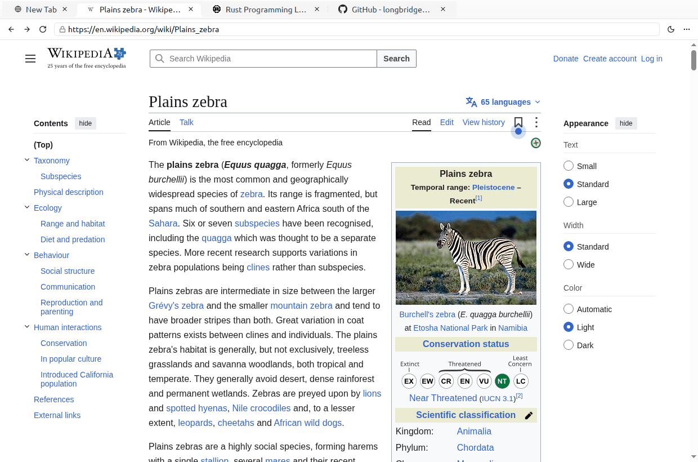
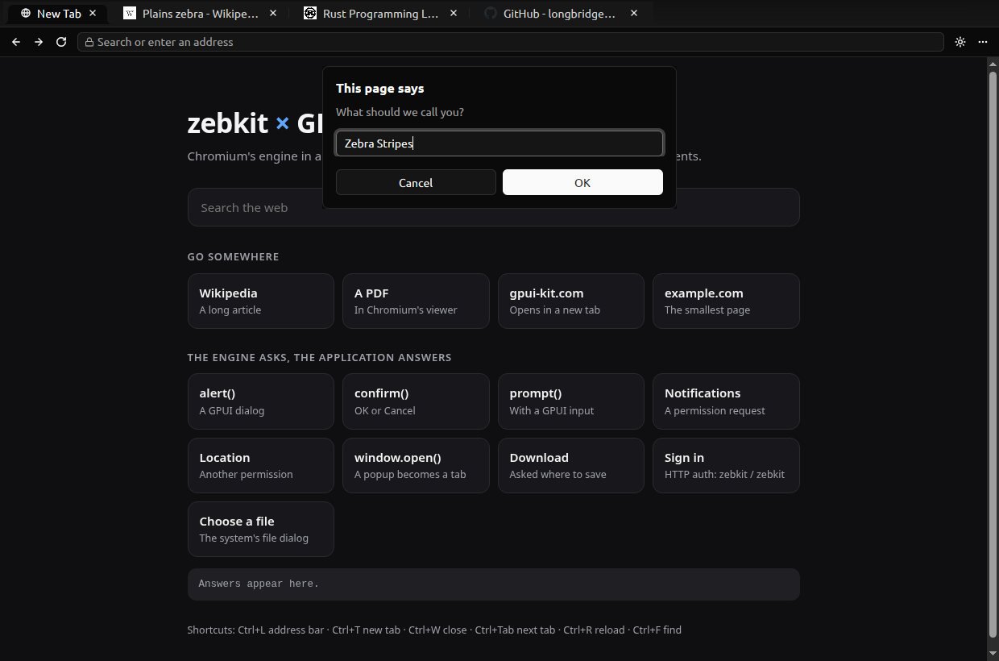

# A browser in GPUI-KIT

A tabbed browser whose window, tabs, toolbar, menus, dialogs and
notifications are [GPUI-KIT](https://github.com/longbridge/gpui-kit)
components (GPUI, Zed's GPU UI framework, with GPUI Component), and whose
pages are zebkit's: Chromium 155 inside the application's process and its
event loop.





## Run it

On Linux, from this directory, after `scripts/build.sh slim && scripts/package.sh slim`
(or with `ZEBKIT_DIR` naming an engine package):

```sh
cargo run --release                        # the start page
cargo run --release -- https://example.com # and more tabs
cargo run --release -- --smoke-test page.png   # loads example.com, checks it drew, exits 0
```

The build needs what GPUI needs: on Debian `libxkbcommon-x11-dev`,
`libxcb1-dev`, `libfreetype-dev`, and a Vulkan driver at run time (Mesa's
`mesa-vulkan-drivers` has a software one). Chromium's switches pass through:
`--remote-debugging-port=9222` serves CDP for the pages, `--no-sandbox` where
the machine has no sandbox for them.

| | |
|---|---|
| Tabs | GPUI-KIT folder tabs with each page's title and icon (fetched by the engine, made a PNG by its image services), a spinner while loading; `+`, close, switch. `window.open()` and `target=_blank` open as tabs, still linked to their opener |
| Toolbar | Back, forward, reload or stop, an address bar that takes an address or searches, a theme switch, a menu (new tab, find in page, save the page as PDF and open it in the engine's PDF viewer, about) |
| Keys | Ctrl+L, T, W, R, F, Ctrl+Tab, Ctrl+Shift+Tab, Alt+Left/Right (Cmd on macOS); while a page has the keyboard the engine keeps them from it and tells the application (`View::set_reserved_keys`) |
| The engine asks, GPUI-KIT answers | A page's `alert()`, `confirm()`, `prompt()` and "Leave site?", permissions (notifications, location, camera, microphone…), downloads, HTTP sign-in and certificate errors: each a hook of zebkit's, each a GPUI-KIT dialog; a `<input type=file>` the system's file dialog through GPUI; a blocked pop-up a notification |
| Theme | GPUI-KIT's light and dark themes, and the pages' `prefers-color-scheme` with them (`View::set_settings`, `colorScheme`) |
| PDF | A PDF opens in its tab in the engine's viewer |
| Start page | From a URL scheme of the application's own (`browser://start/`), with buttons that try each of the engine's questions |

## How little it takes

`src/embed.rs` is the whole integration; the rest is an ordinary GPUI-KIT
application (`src/browser.rs`) and the list of the page's events
(`src/page.rs`). The engine runs in GPUI's event loop, on its main thread:

```rust
let (wake, mut woken) = futures::channel::mpsc::unbounded::<Instant>();
zebkit::set_wakeup(move |delay| drop(wake.unbounded_send(Instant::now() + delay)));
zebkit::init(args)?;
cx.spawn(async move |cx| loop {
    zebkit::pump();
    // ...then wait on GPUI's executor for the engine's deadline or its next wakeup.
})
.detach();
```

A page is a native child window of GPUI's, placed where GPUI laid out the
content area:

```rust
let view = zebkit::View::new(Some(url), 0, 0);
view.attach_native(parent, x, y, width, height)?;   // X11 window, NSView*, HWND
view.on_title(...); view.on_dialog(...); view.on_permission(...); // and the rest

// In the content area's canvas, on every layout:
canvas(move |bounds, window, _| host.layout(bounds, window.scale_factor(), pages), |_, _, _, _| {})
//   -> view.set_bounds(x, y, width, height), in the parent's units
```

The parent is a native surface of GPUI Fast's window composition on X11 and
macOS: it sits between GPUI's content and GPUI's overlays, so menus,
tooltips, notifications and dialogs show over the page. On Windows the
surfaces are DirectComposition visuals, not windows, so the page is a child
of GPUI's window (with `GPUI_DISABLE_DIRECT_COMPOSITION`), and while a dialog
is open the page is hidden and shown as a picture of itself.

## Where it runs

- **Linux, X11.** Built and tried here: tabs, the address bar, every dialog
  above, the PDF viewer, the themes, find, popups, downloads and sign-in,
  under Xvfb with Mesa's software Vulkan. GPUI is made to use X11
  (`gpui_kit::platform::linux(WindowingModes::X11)`, XWayland in a Wayland
  session) and so is the engine (`--ozone-platform=x11`): the engine puts a
  page in an X11 window, not yet in a Wayland surface. Without a compositing
  manager, X11 cannot blend GPUI's overlays over another window, so GPUI
  cuts them out of the page; dialogs have no dimmed backdrop for that reason.
  X11 gives keys to the window under the pointer when the focus is one of
  its ancestors, so GPUI's window does not take the focus itself: an
  input-only child of it does, and passes its keys on (`embed.rs`).
- **Windows.** The page is a child of GPUI's window (no composition
  surface), and this executable is also the engine's sandboxed page
  processes: `zebkit::win_startup()` first in `main`, with the static C
  runtime (`.cargo/config.toml`). Cross-built on Linux for
  `x86_64-pc-windows-msvc` with clang-cl, lld-link and the Windows SDK; the
  smoke test passes on Windows, sandboxed, with Wikipedia in its tab. A build
  made on Linux cannot carry GPUI's shaders, which GPUI compiles with
  Windows' `fxc.exe` (release) or reads from its own source directory at run
  time (debug): that run used a debug build whose shaders were read from
  beside the executable. Built on Windows, as GPUI expects, it should need
  none of that; that was not tried, since the Windows machine only runs tests.
- **macOS.** The code is there (the composition surface's `NSView`, points
  for units, the window's first responder for the keyboard), but it is
  neither built nor tried: GPUI's Metal shaders are made by its build script
  on a Mac only, so it does not cross-build from Linux.

What a browser has that this one does not: zoom, history and bookmarks,
back and forward greyed out when there is nowhere to go (zebkit does not
say yet), a status line for links.
